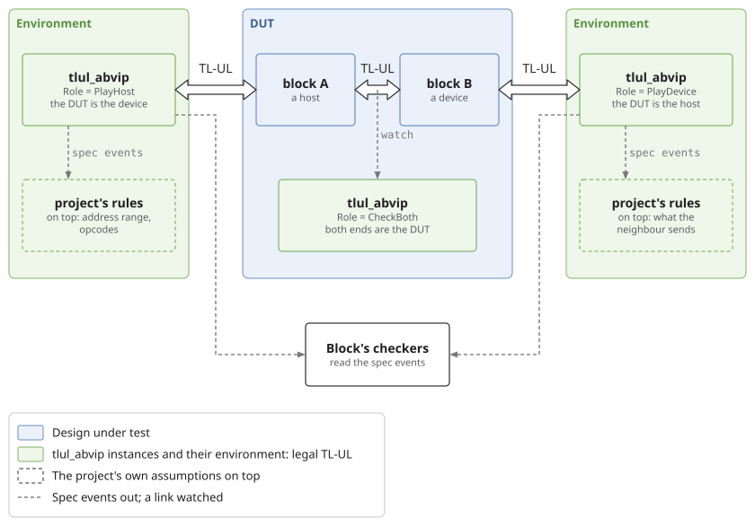
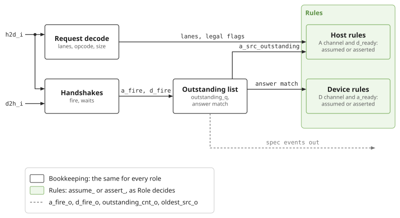

# TL-UL ABVIP

`tlul_abvip` is an assertion-based verification IP (ABVIP) for one TL-UL link in a formal property verification (FPV) testbench.
It watches the link and never drives a wire.
It assumes the TL-UL rules of the end of the link that the formal tool drives, so the tool presents only legal traffic to the design under test (DUT).
It asserts the rules of the end that the DUT drives, so a DUT that breaks the protocol fails.

## Overview

One instance sits on each TL-UL port of the DUT, and one may sit on a TL-UL link between two blocks inside the DUT.
The parameter `Role` selects which end of the link the ABVIP plays.

| `Role` | Use | Host rules | Device rules |
|---|---|---|---|
| `PlayHost` | The DUT is the device on this port | assumed | asserted |
| `PlayDevice` | The DUT is the host on this port | asserted | assumed |
| `CheckBoth` | Both ends of the link are inside the DUT | asserted | asserted |



The ABVIP holds only the rules that the TL-UL specification gives.
A block adds its own restrictions, such as an address range or a set of opcodes, as assumptions of its own beside the instance.
Restrictions that many blocks share are parameters of the ABVIP, described in [Contracts](#contracts).

The rules come from three documents, named by these tags in this page and in the code comments.

| Tag | Document |
|---|---|
| [TL] | SiFive TileLink Specification, version 1.9.3 |
| [TLUL] | [TL-UL bus specification](../../../ip/tlul/README.md) |
| [TLPC] | [TL-UL protocol checker](../../../ip/tlul/doc/TlulProtocolChecker.md) |

The TL-UL bus specification and the protocol checker refer to version 1.7.1 of the TileLink specification.
The section numbers on this page are those of version 1.9.3 and differ from the section numbers of version 1.7.1.

## Terms

A beat is one request on the A channel or one answer on the D channel.
A beat is *presented* in a cycle in which its `valid` is high, whether or not `ready` is high.
A beat *waits* in a cycle in which its `valid` is high and `ready` is low.
A beat is *accepted*, or *taken*, in a cycle in which `valid` and `ready` are both high.
A beat is *held* when it stays presented, with every field unchanged, until it is accepted.
TileLink does not require a sender to hold a beat: [TL] Section 4.1 lets it withdraw or change a beat that was not accepted.
[TL] Section 5.1 uses the word "presented" for a beat that is held, and its forward progress rules apply to such beats.
A request is *outstanding* from the cycle after it is accepted up to and including the cycle in which its answer is taken.
The *active byte lanes* of a request are the `2^a_size` byte lanes that start at the offset of `a_address` within the data bus.

## How it works

The ABVIP decodes the request that is presented, keeps a list of the outstanding requests, and matches each answer to a request.
Every rule is one property over these signals, and `Role` decides whether the property is assumed or asserted.



The list keeps the outstanding requests in the order in which they were accepted, oldest first.
Each entry holds the source, the size, the address offset and whether the request is a `Get`.
An answer names the oldest entry that has its source.
An answer that names no entry belongs to the request that is presented in the same cycle, if that request has the same source.
The list has `MaxOutstanding` entries, so its size follows the port and not the width of the source field.

## Parameters

| Parameter | Default | Description |
|---|---|---|
| `Role` | `PlayHost` | The end of the link that the ABVIP plays, of type `tlul_abvip_pkg::role_e` |
| `SrcW` | `top_pkg::TL_AIW` | The number of low bits of `a_source` and `d_source` that identify a request on this port |
| `MaxOutstanding` | `2 ** SrcW` | The largest number of requests that the host has outstanding at once, and the size of the list |
| `DeviceSameCycleRsp` | 1 | 0: the device answers only a request that it accepted in an earlier cycle |
| `DeviceMaxOutstanding` | `MaxOutstanding` | The largest number of outstanding requests that the device allows before it stops accepting |
| `DeviceRspBound` | 0 | Above 0: the largest number of cycles that the oldest outstanding request spends without its answer presented |
| `DeviceInOrderRsp` | 0 | 1: the device answers in the order in which it accepted the requests |
| `DeviceRspHeld` | 0 | 1: the device holds an answer until the host takes it |
| `HostReqHeld` | 0 | 1: the host holds a request until the device accepts it |
| `Liveness` | 0 | 1: adds the forward progress rules, under the define `FPV_ON` that the OpenTitan formal flow sets |

The ABVIP compares only the low `SrcW` bits of the source fields.
At its default, `MaxOutstanding` adds nothing to the rule `Src_Unique`.
A lower value restricts the host through the rule `Src_WithinMaxOutstanding`, so the testbench that sets it states the reason, as for a contract.

## Ports

| Port | Direction | Description |
|---|---|---|
| `clk_i` | input | The clock of the link |
| `rst_ni` | input | The reset of the link, active low |
| `h2d_i` | input | The signals that the host drives, of type `tlul_pkg::tl_h2d_t` |
| `d2h_i` | input | The signals that the device drives, of type `tlul_pkg::tl_d2h_t` |
| `a_fire_o` | output | A request is accepted in this cycle |
| `d_fire_o` | output | An answer is taken in this cycle |
| `outstanding_cnt_o` | output | The number of outstanding requests at the start of this cycle |
| `oldest_src_o` | output | The source of the oldest outstanding request |

The four outputs let a block's own assumptions and checkers refer to the same events as the ABVIP.

## Rules

Each rule is a named property in `tlul_abvip.sv`.
Its label is the property name with the prefix `assume_` or `assert_`, for example `assert_Rsp_SizeMatchesReq`.
A name that starts with `Req_` is about signals that the host drives, and a name that starts with `Rsp_` is about signals that the device drives.
A name that starts with `Src_` is a rule on the source fields, and a name that starts with `Live_` is a forward progress rule.

### Host rules

The ABVIP assumes the host rules with `Role` `PlayHost`, and asserts them with `PlayDevice` and `CheckBoth`.

| Property | Rule | Source |
|---|---|---|
| `Req_OpcodeLegal` | The opcode of a presented request is `Get`, `PutFullData` or `PutPartialData` | [TL] Section 7, Table 15 |
| `Req_ParamZero` | `a_param` of a presented request is 0 | [TL] Sections 7.2.1 to 7.2.3 |
| `Req_SizeFitsBus` | A presented request covers no more bytes than the data bus has | [TL] Sections 7.2.1 to 7.2.3 |
| `Req_Aligned` | `a_address` of a presented request is aligned to `a_size` | [TL] Sections 7.2.1 to 7.2.3 |
| `Req_MaskInLanes` | `a_mask` of a presented request is low on every byte lane that is not active | [TL] Section 4.5 |
| `Req_FullMask` | `a_mask` of a presented `Get` or `PutFullData` is high on every active byte lane | [TL] Section 4.5 |
| `Src_Unique` | The source of a presented request is not the source of an outstanding request | [TL] Section 6.4 |
| `Src_WithinMaxOutstanding` | A request is presented only while fewer than `MaxOutstanding` requests are outstanding, or while an answer to one of them is taken | [TLPC]; the parameter `MaxOutstanding` |
| `Req_NoValidAtReset` | `a_valid` is low at the first rising clock edge at which reset is inactive | [TL] Section 3.2.2 |

### Device rules

The ABVIP assumes the device rules with `Role` `PlayDevice`, and asserts them with `PlayHost` and `CheckBoth`.

| Property | Rule | Source |
|---|---|---|
| `Src_RspHasReq` | A presented answer has the source of an outstanding request or of the request presented in the same cycle | [TL] Sections 4.2 and 5.1 |
| `Rsp_OpcodeMatchesReq` | The answer to a `Get` is `AccessAckData`, and the answer to a write is `AccessAck` | [TL] Section 7, Table 15 |
| `Rsp_SizeMatchesReq` | `d_size` of an answer is `a_size` of its request | [TL] Sections 7.2.4 and 7.2.5 |
| `Rsp_ParamZero` | `d_param` of a presented answer is 0 | [TL] Sections 7.2.4 and 7.2.5 |
| `Rsp_SameCycleTaken` | An answer to a request that is not yet outstanding is taken only in a cycle in which that request is accepted | [TL] Section 4.2 |
| `Rsp_NoValidAtReset` | `d_valid` is low at the first rising clock edge at which reset is inactive | [TL] Section 3.2.2 |

`Rsp_SameCycleTaken` applies with `DeviceSameCycleRsp` 1.
With `DeviceSameCycleRsp` 0 the rule `Rsp_NotSameCycle` takes its place.

### Contracts

A contract is a rule that is stricter than TileLink.
It is off at the default value of its parameter, and the parameter turns it on for a port whose host or device is known to keep it.
`Req_Held` is a contract of the host and is assumed or asserted like a host rule.
The other five are contracts of the device and are assumed or asserted like a device rule.
A contract that the ABVIP assumes restricts the traffic that the proofs see, so the testbench that sets the parameter states the reason.

| Property | Parameter | Rule |
|---|---|---|
| `Req_Held` | `HostReqHeld` 1 | A request that waits is presented again in the next cycle with every field unchanged |
| `Rsp_Held` | `DeviceRspHeld` 1 | An answer that waits is presented again in the next cycle with every field unchanged |
| `Rsp_InOrder` | `DeviceInOrderRsp` 1 | While a request is outstanding, a presented answer has the source of the oldest outstanding request |
| `Rsp_NotSameCycle` | `DeviceSameCycleRsp` 0 | No answer is presented to a request that is not yet outstanding |
| `Src_WithinDeviceMaxOutstanding` | `DeviceMaxOutstanding` below `MaxOutstanding` | A request becomes outstanding only while fewer than `DeviceMaxOutstanding` requests are outstanding, or while an answer to one of them is taken |
| `Rsp_WithinBound` | `DeviceRspBound` above 0 | The oldest outstanding request spends at most `DeviceRspBound` cycles without its answer presented |

The count of `Rsp_WithinBound` starts when a request becomes the oldest outstanding request.
It stops in a cycle in which the answer to that request is presented, and goes on if the device withdraws the answer.
[TL] Section 4.1 lets a sender withdraw or change a beat that was not accepted, and [TL] Section 6.5 lets a device answer in any order.

### Known values

These rules follow the known-value checks of [TLPC].
The ABVIP asserts them on the end that the DUT drives and never assumes them.

| Property | Rule | [TLPC] check |
|---|---|---|
| `Req_ValidKnown` | `a_valid` is never X | `aKnown` |
| `Req_FieldsKnown` | The fields of a presented request, other than `a_data`, are not X | `aKnown` |
| `Req_DataKnown` | The bytes of `a_data` that the mask of a presented write marks are not X | `aDataKnown` |
| `Req_DReadyKnown` | `d_ready` is never X | `dReadyKnown` |
| `Rsp_ValidKnown` | `d_valid` is never X | `dKnown` |
| `Rsp_FieldsKnown` | The fields of a presented answer, other than `d_data`, are not X | `dKnown` |
| `Rsp_DataKnown` | The bytes of `d_data` in the active byte lanes of the answered `Get` are not X | `dDataKnown` |
| `Rsp_AReadyKnown` | `a_ready` is never X | `aReadyKnown` |

### Forward progress

The forward progress rules are liveness properties.
They exist with `Liveness` 1 and the define `FPV_ON`.
[TL] Section 5 gives them as rules 3i and 3ii, with the exemption that an agent need not accept a request while its own answer waits.

| Property | Kind | Rule |
|---|---|---|
| `Live_HostTakesRsp` | host rule | A presented answer is eventually taken, withdrawn or changed |
| `Live_DeviceAcceptsReq` | device rule | A presented request is eventually accepted, withdrawn or changed, unless an answer of the device is held and waits |
| `Live_DeviceAnswersReq` | device rule | While a request is outstanding, the answer to the oldest outstanding request is eventually presented and held until it is taken |

### What the ABVIP does not check

- **Error answers.**
  With `Role` `PlayHost` the ABVIP assumes that every request is well formed, so a proof does not reach the answer of the DUT to a malformed request.
  No rule restricts `d_error`: any answer may carry it.
- **Bus integrity.**
  The ABVIP does not compute the integrity codes in `a_user` and `d_user`.
- **Reset length.**
  The ABVIP does not check how long `a_valid` and `d_valid` are low during reset, a TileLink requirement that [TLUL] does not adopt.
- **Upper source bits.**
  The ABVIP does not compare the bits of `a_source` and `d_source` above `SrcW`.

## Byte lane examples

The table shows the request rules on a 32-bit data bus, which has four byte lanes.
The offset is the low two bits of `a_address`.

| Opcode | Offset | `a_size` | `a_mask` | Legal | Rule that decides |
|---|---|---|---|---|---|
| `Get` | 0 | 2 | `1111` | yes | |
| `PutPartialData` | 1 | 0 | `0010` | yes | |
| `PutPartialData` | 2 | 1 | `1100` | yes | |
| `PutPartialData` | 0 | 2 | `1001` | yes | |
| `PutFullData` | 3 | 0 | `1000` | yes | |
| `Get` | 2 | 1 | `0100` | no | `Req_FullMask` |
| `Get` | 0 | 2 | `0000` | no | `Req_FullMask` |
| `Get` | 0 | 2 | `0101` | no | `Req_FullMask` |
| `PutFullData` | 0 | 2 | `0111` | no | `Req_FullMask` |
| `Get` | 0 | 3 | `1111` | no | `Req_SizeFitsBus` |
| `PutPartialData` | 1 | 1 | `0110` | no | `Req_Aligned` |
| `PutPartialData` | 2 | 0 | `0001` | no | `Req_MaskInLanes` |
| opcode 2 | 0 | 2 | `1111` | no | `Req_OpcodeLegal` |

## Covers

Every instance has covers that show its assumptions leave legal traffic.
They cover each opcode and each size, a request and an answer that wait, a request that is withdrawn, an answer taken in the cycle in which its request is accepted, an answer out of order, a source that is used again, an error answer, and a full list.
A cover whose case a contract forbids is left out when the parameter of that contract is set.

## How to use it

The FuseSoC core of the testbench depends on `lowrisc:dv:tlul_abvip`.
The testbench instantiates one ABVIP per TL-UL port, in its top module or in a module that it binds into the DUT.

```systemverilog
tlul_abvip #(.Role(tlul_abvip_pkg::PlayHost)) u_tlul_abvip (
  .clk_i,
  .rst_ni,
  .h2d_i            (tl_i),
  .d2h_i            (tl_o),
  .a_fire_o         (tl_a_fire),
  .d_fire_o         (tl_d_fire),
  .outstanding_cnt_o(),
  .oldest_src_o     ()
);
```

A block states its own restrictions as assumptions beside the instance.

```systemverilog
assume_Tl_NoPartialWrite : assume property (
  tl_i.a_valid |-> (tl_i.a_opcode != tlul_pkg::PutPartialData));
```

## Relation to `tlul_assert`

[`tlul_assert`](../../../ip/tlul/rtl/tlul_assert.sv) is the protocol checker that [TLPC] describes, which the testbenches of the OpenTitan blocks bind to their TL-UL ports.
The ABVIP is a separate module and changes nothing in `tlul_assert`.
The two modules differ in these points.

- **Assumed requests.**
  `tlul_assert` in `"Device"` mode assumes four of its request checks and asserts that the device answers a malformed request with `d_error`.
  The ABVIP in `PlayHost` assumes every host rule, so the DUT sees only well-formed requests.
- **Byte lanes.**
  `tlul_assert` compares the number of set mask bits with `a_size`.
  The ABVIP compares the mask with the active byte lanes, for `Get` as well as for `PutFullData`.
- **Handshake rules.**
  The ABVIP adds the reset rule, the rule on an answer to a request that is not yet outstanding, and the forward progress rules.
- **State.**
  `tlul_assert` keeps one entry per value of the source field.
  The ABVIP keeps `MaxOutstanding` entries in request order, which gives it the oldest request for the ordering and latency contracts.

## Self-check

`fpv/tlul_abvip_selfcheck.sv` checks the ABVIP against itself, with no design.
It puts one instance of each role on one link whose signals are all free inputs.
Every rule that the `PlayHost` or the `PlayDevice` instance assumes, the `CheckBoth` instance asserts on the same link, so these assertions hold by construction.
The covers and the assertions below carry the result.
Its covers show that the assumed rules together allow long legal traces: eight answers taken, four requests accepted in four cycles, a request and an answer in each of four cycles, and a list that fills and drains.
Its assertions show that no request in the illegal rows of the [byte lane examples](#byte-lane-examples) can be presented, and that the request rules imply the `sizeMatchesMask` check of [TLPC] for `Get` and `PutFullData`.
The module takes the parameters of the ABVIP and passes them to all three instances.
Its FuseSoC core is `lowrisc:fpv:tlul_abvip_selfcheck_fpv`.
