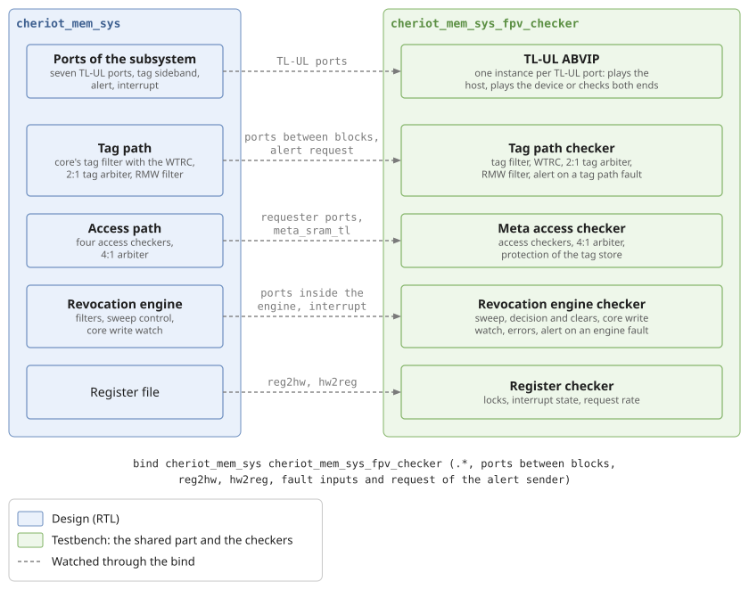

# CHERIoT memory subsystem FPV testplan

This page is the plan of a new FPV environment for the CHERIoT memory subsystem in Earl Grey.
The environment proves the requirements of the tag path, the access rules of the meta SRAM, the revocation engine and the registers.
[Scope](#scope) lists what it checks and what it leaves out.
Every requirement names its source and the checks that decide it.

## The CHERIoT memory subsystem in Earl Grey
A CHERIoT capability is 65 bits wide: a 32-bit pointer, 32 bits of metadata and one validity tag bit.
OpenTitan's bus is 32 bits wide, so the core moves a capability in two accesses and carries the tag on a sideband signal next to the bus.
The sideband is a multi-bit signal, and only the value `MuBi4True` means that the tag is set.
The subsystem sits between the CHERIoT-capable Ibex core and the main crossbar `xbar_main`.
It stores the tags, and the revocation bitmap of the heap, in a meta SRAM.
The input `cheriot_ena_i` selects the mode: CHERIoT mode when it is `MuBi4True`, and ePMP mode, in which the core uses no capabilities, for any other value.
The top's configuration sets the address ranges of the main SRAM, the NVM and the meta SRAM ([Parameters](requirements.md#parameters)).
The subsystem does these jobs with its neighbours:

* With the Ibex core, it splits each data access into a data access towards the crossbar and a tag access towards the meta SRAM, and it joins the two answers.
  It also answers the core's reads of the revocation bitmap, which the core makes on every capability load.
* With `xbar_main`, it forwards the data half of each access, serves the register interface and the window onto the revocation bitmap, and lets the revocation engine read the SRAMs and the NVM.
* With the meta SRAM controller, it merges four requesters onto the one port `meta_sram_tl`: the tag path, the core's bitmap reads, the engine's bitmap reads and the system's bitmap window.
  An access checker in front of each requester lets through only full-word accesses to the region that the requester owns.
* On its own, a background revocation engine sweeps a range of capabilities and clears the tag of each capability whose base is revoked.
  The engine raises the interrupt `tbre_done` when a sweep ends.
* To the alert handler, it reports the fatal alert `fatal_fault`.

The environment sits at the subsystem's own ports.
It drives every input, and it checks the outputs that the table marks as checked.
The table lists the ports of each neighbour and what the environment does with them.
It also lists the clock and the reset, which the figure leaves out.
An input marked free can take any value in any cycle.

| Neighbour | Ports: subsystem inputs; outputs | In the environment |
|---|---|---|
| Ibex core | `cored_tl_d` requests, `cored_tag_h2d`, `corerevbm_tl` requests; `cored_tl_d` answers, `cored_tag_d2h`, `corerevbm_tl` answers | Core rules assumed ([Assumptions](#assumptions)); `cored_tag_h2d` takes any 4-bit value that these rules allow, an invalid encoding included; answers checked |
| Mode switch in `rv_core_ibex` | `cheriot_ena_i` | Any 4-bit value, the same from reset ([Constraints](#constraints)) |
| Main crossbar `xbar_main` | `regs_tl_d` requests, `revbm_tl_d` requests, `cored_tl_h` answers, `tbre_tl_h` answers; `regs_tl_d` answers, `revbm_tl_d` answers, `cored_tl_h` requests, `tbre_tl_h` requests | TL-UL host rules assumed on the requests it sends, device rules on the answers it sends ([Assumptions](#assumptions)); the subsystem's answers and requests checked |
| Meta SRAM controller | `meta_sram_tl` answers; `meta_sram_tl` requests | Device rules assumed ([Assumptions](#assumptions)); requests checked |
| Alert handler | `alert_rx_i`; `alert_tx_o` | `alert_rx_i` free; the request that reaches the alert sender checked, and not the handshake on the pair |
| Interrupt controller | `intr_tbre_done_o` | Checked |
| Clock and reset managers | `clk_i`, `rst_ni` | One clock; every proof starts with the reset applied ([Proofs](#proofs)) |

## How the plan fits together
The plan is a chain of four parts.
Each part points to the next, so a specification section leads to the assertions that check it, and a failing assertion leads back to the specification text.

1. **Specification.**
   The documents that say what the subsystem must do: [Sources](#sources) lists them.
2. **Requirements** ([requirements.md](requirements.md)).
   234 statements of what the subsystem must do, in 15 groups, one group per feature.
   Each requirement names its source.
3. **Testpoints** ([testplan](../../data/cheriot_mem_sys_fpv_testplan.hjson)).
   40 entries of the testplan.
   A testpoint is one behaviour of a feature that must be shown to hold, written as one or two sentences, with the requirements it covers.
   A testpoint is not a module of the testbench.
   The module that proves it is a checker, and one checker proves one or more testpoints ([Feature checkers](#feature-checkers)).
4. **Checks.**
   155 checks, the rows of the testpoints' check tables.
   A check is a sentence that says what must hold.
   Each has a planned assertion, named `assert_<Testpoint>_<Check>`.
   A requirement names the checks that decide it, and why.

Two more words describe the testbench.
A checker is a module that holds the assertions of one part of the subsystem ([Feature checkers](#feature-checkers)).
A proof is one run of the formal tool on the assertions of one checker, or of a part of them ([Proofs](#proofs)).
The design also has access checkers.
They are blocks of the subsystem and not part of the testbench.

### One example through the chain
| Step | Example |
|---|---|
| Specification | [Tag Filter](../theory_of_operation.md#tag-filter); [cheriot.rst, Data Memory Tag Interface](../../../../vendor/lowrisc_ibex/doc/03_reference/cheriot.rst) |
| Requirement | [REQ_TF_02a](requirements.md#req_tf_02a): In CHERIoT mode, a 64-bit-aligned read to a tagged region that the core hints as a capability load shall issue a meta request. |
| Testpoint | [`tf_lookup`](../../data/cheriot_mem_sys_fpv_testplan.hjson#tf_lookup): A request that needs a tag issues exactly one meta request, in the same cycle. Every other request issues none. |
| Checker | The tag path checker, the module that holds the assertions of `tf_lookup` |
| Check | *lookup in same cycle*, one of the 3 checks of `tf_lookup` (*lookup in same cycle*, *no unneeded lookup*, *lookup carries valid integrity*) |
| Planned assertion | `assert_TfLookup_LookupInSameCycle` |
| Why the check proves the requirement | For every request that needs a lookup, the check requires its meta request. A hinted aligned read to a tagged region in CHERIoT mode is one, so a missing lookup fails it. |

### Sources
Each requirement names its source: a section, a register or a configuration key of the documents below.
Where none of these documents states the rule, the requirement says so.

| Source | Documents | What the plan takes from them |
|---|---|---|
| The block specification | [theory of operation](../theory_of_operation.md), [interfaces](../interfaces.md), [programmer's guide](../programmers_guide.md), [registers](../registers.md), [overview](../../README.md), [block description](../../data/cheriot_mem_sys.hjson) | The rules of every datapath block, register, alert and countermeasure |
| The core | [Ibex CHERIoT extension](../../../../vendor/lowrisc_ibex/doc/03_reference/cheriot.rst), [Ibex load-store unit](../../../../vendor/lowrisc_ibex/doc/03_reference/load_store_unit.rst), [`rv_core_ibex` theory of operation](../../../../top_earlgrey/ip_autogen/rv_core_ibex/doc/theory_of_operation.md), CHERIoT architecture specification v1.0 | What the core sends and expects: the tag signals, the order of its accesses, the capability rules |
| Common rules | [TL-UL](../../../tlul/README.md), [TL-UL protocol checker](../../../tlul/doc/TlulProtocolChecker.md), [comportability](../../../../../doc/contributing/hw/comportability/README.md), TileLink specification 1.9.3 | Bus handshakes and answers, interrupts and register behaviour |

### Check kinds
The testplan gives each check a kind:

| Kind | What it says |
|---|---|
| `forward` | When the cause happens, the design responds, and in time. |
| `backward` | The design responds only when the cause happened. |
| `both` | The check holds in both directions: the design responds when the cause happens, and only then. |
| `safety` | The condition holds in every cycle, whatever came before. |
| `liveness` | Something must happen at some point, for example that every request is accepted and answered. The check needs the neighbours to accept and answer too ([Assumptions](#assumptions)). |
| `stable` | A value does not change without its cause. |

## Scope
### Features
The table names the part of the testbench that checks each feature of the subsystem.

| Feature | Checked by |
|---|---|
| The core's tag filter, including the capability store to the NVM that the write-to-read-and-compare filter (WTRC) handles | The tag path checker |
| The 2:1 tag arbiter and the read-modify-write (RMW) filter | The tag path checker |
| The access checkers and the 4:1 arbiter in front of `meta_sram_tl`, and the protection of the tag store | The meta access checker |
| The revocation engine: start, status and interrupt, the sweep, the decision and the tag clears, the watch on the core's writes, errors | The revocation engine checker |
| The registers that the hardware writes or locks: the sweep registers and their lock, the interrupt state and the request rate of the register interface | The register checker |
| The fatal alert | The tag path checker for the faults of the tag path, the revocation engine checker for the faults of the engine |
| The TL-UL protocol on every port | The TL-UL ABVIP |
| The tag read after a write, the absence of a deadlock and a revoked capability's tag after a sweep | The checks of the checkers above, combined |

[Testbench architecture](#testbench-architecture) describes each of these parts.

### Security countermeasures
The block description lists the security countermeasures of the subsystem.
OpenTitan's testplan for them is [`cheriot_mem_sys_sec_cm_testplan.hjson`](../../data/cheriot_mem_sys_sec_cm_testplan.hjson).
The table shows what each countermeasure is and which testpoints of this plan check the behaviour behind it.
Each testpoint is due at the stage of its feature ([Sign-off criteria per stage](#sign-off-criteria-per-stage)), so the testpoints of one countermeasure can sit at different stages.
The testpoints of the fatal alert and of the protection of the tag store are due at stage V2S.

| Countermeasure | What it is | Testpoints |
|---|---|---|
| `BUS.INTEGRITY` | End-to-end bus integrity. Every request that the subsystem generates carries a valid command integrity code. | `tf_lookup`, `wtrc_store`, `rmw_read`, `rmw_write_back`, `tbre_sweep`, `tbre_decision` |
| `MEM.SW_NOACCESS` | The capability tag store is not memory mapped. No request outside its requester's region reaches the meta SRAM. | `meta_refuse`, `tag_isolation` |
| `INTERSIG.MUBI` | The mode enable is a multi-bit signal. Any value other than `MuBi4True` is ePMP mode, which the meta SRAM does not serve. | `tf_lookup`, `meta_refuse`, `tag_isolation` |
| `CORED_TAG.INTERSIG.MUBI` | The tag sideband of the core's data port is a multi-bit signal. Only `MuBi4True` reads as a set tag, and a request with an invalid encoding raises the fatal alert. | `tf_meta_request`, `tf_sticky_tag`, `tag_alerts` |

### Out of scope
The plan leaves out the cases below.
Each point gives the reason.

* **The TL-UL integrity functions.**
  The environment computes the integrity codes it expects with the same functions that the design uses.
  It therefore checks that the subsystem encodes the right fields and that it rejects a wrong code.
  It does not check that the functions compute the right code.
* **A core that breaks its own access order.**
  The core loads and stores a capability as two words in a fixed order, and it stores each word whole.
  The proofs assume this ([Assumptions](#assumptions)), so they never present a word of a capability store that is out of the order or partial, or another request between the two words.
  The plan therefore does not check the error answer and the alert that the subsystem gives for such a request.
* **An invalid tag sideband on the upper word of a capability.**
  The proofs assume that the core sets the tag sideband on the upper word of a capability load and of a capability store to the NVM ([Assumptions](#assumptions)).
  They therefore never present an invalid encoding on that word.
  For the tag of such a word, the theory of operation gives two answers: the tag captured with the lower word ([Tag Filter](../theory_of_operation.md#tag-filter)) and an untagged answer ([Error Handling](../theory_of_operation.md#error-handling)).
  The plan checks neither the tag nor the alert for an invalid encoding on that word.
* **The alert sender.**
  The subsystem hands its alert request to the alert sender `prim_alert_sender`, which drives `alert_tx_o`.
  The proofs watch the request that reaches the sender and leave `alert_rx_i` free.
  The plan therefore does not check the handshake on the alert pair, or that a raised alert stays raised until reset.
* **The reset value and the access type of each register field.**
  The register checker holds a model of the registers that the hardware writes or locks ([Register checker](#register-checker)).
  It holds no model of every field.
  The plan therefore does not check the reset values, the access types, or that the error bits of `TBRE_STATUS` stay set until software clears them.
* **The alert on a register request with a broken integrity code.**
  The register checker has no check that watches the alert request of the register file.
  The plan therefore does not check the alert that a request with a broken integrity code raises on `regs_tl_d`.
* **The alert test register.**
  `ALERT_TEST` requests an alert on a software write, and no feature of the subsystem depends on it.
  The plan has no check of the test write or of its lock.
* **The lockstep countermeasure and the end-to-end part of bus integrity.**
  The block description marks `LOGIC.SHADOW`, the lockstep operation of the subsystem, as not implemented, and it says that `BUS.INTEGRITY` relies on `LOGIC.SHADOW`.
  No document states what the lockstep requires of the subsystem.
  The plan checks the integrity rules that the documents give for each port, and it has no requirement for the lockstep.

## Testbench architecture
This is the planned architecture.
The formal top is the whole `cheriot_mem_sys`, with Earl Grey's parameters.
One environment module, `cheriot_mem_sys_fpv_env`, holds the design with every input free.
One checker module, `cheriot_mem_sys_fpv_checker`, is bound into the design; it holds the shared part and the four checkers of this section.
A bound module is attached to the design and reads its signals, and the design itself stays unchanged.
The checker module reads every port of the subsystem and these internal signals:

* the ports between the blocks of the tag path and of the revocation engine, such as the input and the output of the 2:1 tag arbiter;
* the register file's outputs to the hardware and the hardware's writes into the registers;
* the fault inputs of the alert logic and the request that reaches the alert sender.

Each rule that the environment makes about a neighbour is written once.
The formal tool assumes it, and a simulation of the same bind asserts it.

The environment has one shared part and four checkers.
The shared part is described first.

### TL-UL ABVIP
`tlul_abvip` is a set of TL-UL protocol assertions for formal.
ABVIP stands for assertion-based verification IP.
An instance sits on each TL-UL port of the subsystem and plays one of three roles:

* **Plays the host.**
  The instance assumes that the host follows the TL-UL rules and asserts that the device follows them.
  It sits on the ports where a neighbour sends requests.
* **Plays the device.**
  The instance does the reverse, on the ports where a neighbour answers.
* **Checks both ends.**
  The instance assumes nothing and asserts every rule.
  It sits on a link between two blocks of the subsystem, where both ends are real.

An instance holds the rules of TL-UL only.
A rule that is specific to this design, such as which addresses hold capabilities or the order of a capability's two words, is an assumption on top of the instance ([Assumptions](#assumptions)).
The testpoint `tlul_protocol` holds the one check that the TL-UL rules hold on every port.

### Feature checkers
| Checker | What it checks | Testpoints it proves |
|---|---|---|
| Tag path checker | The core's tag filter with the WTRC, the 2:1 tag arbiter and the RMW filter, and the alert on a tag path fault | `tf_*`, `wtrc_*`, `arb_*`, `rmw_*`, `tag_alerts` |
| Meta access checker | The four access checkers and the 4:1 arbiter onto `meta_sram_tl`, and the protection of the tag store | `meta_*`, `tag_isolation` |
| Revocation engine checker | The engine with its TRVK filter and tag filter, the sweep control and the interrupt, the watch on the core's writes, and the alert on an engine fault | `tbre_*` |
| Register checker | The register file: the locks while a sweep runs, the interrupt state and the request rate | `csr` |

The testpoints `contracts`, `alert_causes` and `tlul_protocol` hold checks on the blocks of several checkers.
Each of their checks is proven in the proof of the checker that holds its block ([Proofs](#proofs) says what a contract is).
The testpoints `tag_read_after_write`, `tag_no_deadlock` and `rev_end_to_end` have no assertions of their own.
Each follows from the checks of the checkers that cover its path, from port to port, and the testplan names those checks.
The tag read after a write also relies on one assumption: the meta SRAM returns the word last written ([Assumptions](#assumptions)).
The meta access checker repeats its checks for each of the four requester ports.
Each assertion has the name that its check plans, such as `assert_TfMetaRequest_TagWordAndBit`.

### Register checker
The register checker proves the register file on its own.
The real register file is the only block in the proof, and the hardware side of the registers is free, so the proof holds for every behaviour of the engine.
The checker keeps a model of the value that `TBRE_STATUS.busy` holds, which is the hardware's last write.
The model also gives the data that a good read of `TBRE_BASE_ADDR`, `TBRE_NUM_CAPS`, `TBRE_REGWEN` or `TBRE_STATUS.busy` must return.
A good request is a whole aligned word with valid command and data integrity.
The checks claim nothing about the data of any other request, which the register file may answer with an error.
The proof reaches the cases in which the hardware lowers `TBRE_REGWEN` and raises it again, because the hardware side is free.

### Independence from the RTL
Each assertion compares the design with an expected value, for example the tag word that an address maps to.
If a checker took such a value from the RTL, a wrong value in the RTL would be wrong on both sides, and the assertion would still pass.
The environment therefore takes its expected values from the documents, except where a row of the table says otherwise, and for the values named after it.

| Expected value | Where the environment takes it from |
|---|---|
| The address ranges of the regions | The parameters of `interfaces.md` |
| The tag word of an address, and the revocation word and bit of a heap address | The meta SRAM address map of the theory of operation |
| The tag bit of an address within its word | No document states the bit order of the tags. The environment takes the order that the theory of operation states for the revocation bitmap. |
| The swept capabilities of a sweep and the starts that are taken | The revocation engine section of the theory of operation |
| A capability's base and whether it is a sealing capability | The CHERIoT architecture specification, which the environment decodes itself |
| Which accesses an access checker lets through | The access checkers section of the theory of operation |
| TL-UL integrity codes | The integrity functions of `tlul_pkg`, in the RTL |

The integrity codes come from the RTL, which is why the integrity functions are [out of scope](#out-of-scope).
The environment also takes the port types and widths, the multi-bit mode constants and the register offsets from the RTL's packages, as the definition of the interface it connects to.

## Verification strategy
Three words describe how the proofs are set up:

* An **abstraction** lets a part of the design, or its start state, take more values than it really can, or leaves a part out, so that one proof covers more cases.
  It removes no real behaviour.
* A **constraint** narrows what the proofs explore.
  Each constraint says what it leaves unchecked.
* An **assumption** is a rule that the environment makes the neighbours of the subsystem follow.
  Each assumption names the document that gives the rule, or says that no specification gives it.

### Proofs
The whole subsystem in one proof may never finish, so the plan splits it by feature.
Each feature proof holds the real blocks of one checker and cuts the blocks outside it ([Abstractions](#abstractions)).
Every proof starts with the reset applied.

| Proof | Checker | Testpoints | Start state and setup |
|---|---|---|---|
| Tag path | Tag path checker | `tf_*`, `wtrc_*`, `arb_*`, `rmw_*`, `tag_alerts` | Real: the core's tag filter with the WTRC, the 2:1 tag arbiter, the RMW filter, the core write watch and the alert logic. Every other block is cut. |
| Meta access | Meta access checker | `meta_*`, `tag_isolation` | Real: the four access checkers and the 4:1 arbiter. Every other block is cut. |
| Revocation engine | Revocation engine checker | `tbre_*` | Real: the engine with its filters, the sweep control, the core write watch, the 2:1 tag arbiter and the alert logic. The register file follows a model, and the epoch count starts at any value. Every other block is cut. |
| Register file | Register checker | `csr` | Real: the register file. Every other block is cut. |
| Whole subsystem | All checkers | Every assertion of the four checkers, `contracts` included | Every block is real. |
| The design's own assertions | None: the assertions written in the RTL | - | As in the feature proof that holds them |

A cut block is free, so a checker sometimes needs one property of it.
Such a property is a contract: one checker assumes it about a block that its proof cuts, and another checker proves it on the real block.
The testpoint `contracts` holds the checks that prove the contracts.
Two examples are that the engine's tag filter keeps a request unchanged until it is accepted, and that the RMW filter accepts and answers every request.
No proof assumes a contract that was proven with its own help.
The proofs therefore run in an order: a proof starts when the contracts that it assumes are proven by earlier proofs.
A check runs in a proof of its own where it needs an assumption that would narrow the other checks of its checker, or where proving it with them would close a cycle of contracts.
The checks of kind `liveness` are the usual case.
The check of a malformed answer to the engine also runs in a proof of its own, which leaves out the TL-UL rules on the opcode and the size of an answer.
The whole-subsystem proof assumes only the rules on the subsystem's own ports.
It shows that the contracts and the rules on the internal neighbours were the right ones.
The sweep of the engine and the number of capabilities make its state space deep, so it runs to a bounded depth first, and its result names the depth.

### Abstractions
The proofs use the abstractions below.
The column Start state and setup of [Proofs](#proofs) shows which proof uses each one.
No abstraction edits the RTL.

| Abstraction | What the proof does | Why the result holds for the design | What it does not show |
|---|---|---|---|
| A block outside the checker is cut | The proof leaves the block out, and its outputs take any value that TL-UL allows. A contract limits them where a check needs it. | The free outputs include every value that the real block produces. An assertion that holds for all of them holds for the real block too. | Whether the block produces the right values. The checker that holds the block proves that. |
| The register file follows a model | The revocation engine proof cuts the register file. Its outputs follow its rules: the sweep range is locked while `TBRE_REGWEN` is 0, the start strobe comes only while it is 1, the interrupt state rises only on a set request, and `TBRE_STATUS.busy` shows what the engine wrote. | The register checker proves that the real register file follows these rules for every behaviour of the engine. | The lock and the status that software reads through `regs_tl_d`. The register checker checks them. |
| The epoch count starts at any value | In the revocation engine proof, `TBRE_EPOCH.count` starts at any value instead of 0, so the proof reaches the wrap of the count without running every sweep before it. | Every start value is one that the count reaches after enough sweeps. | The reset value of the count. |

### Constraints
Each constraint narrows what the proofs explore.
Its last sentence says what it leaves unchecked.

* **The mode enable keeps its value from reset** (`cheriot_ena_i`).
  The mode enable is driven by a write-once switch in `rv_core_ibex` ([Block Diagram](../theory_of_operation.md#block-diagram)), and a proof takes each of its 16 values.
  The Ibex documentation requires software to run no load and no store while the mode changes ([cheriot.rst, Switching to CHERIoT Mode at Runtime](../../../../vendor/lowrisc_ibex/doc/03_reference/cheriot.rst)).
  No document says what the subsystem does with an access that is in flight when the mode enable changes.
  The proofs therefore do not check the change from one value to another.
* **No parameter is reduced.**
  The proofs run with the parameter set of Earl Grey, which is the only set that the block's documents support ([Supported Parameter Sets](../interfaces.md#supported-parameter-sets)).
  The plan does not show that the requirements hold for another parameter set.

### Assumptions
The environment assumes the rules below about the neighbours of the subsystem.
Every other input is free.
This includes every address, opcode, size, mask and data value that TL-UL allows, and every value of the tag sideband, an invalid encoding included.
It also includes every `d_error`, every integrity value, a broken one included, and any content of a meta SRAM word.

* **The core keeps a request unchanged until the subsystem accepts it** (`cored_tl_d`, `cored_tag_h2d`).
  The theory of operation requires this of the host on `cored_tl_d` ([Block Diagram](../theory_of_operation.md#block-diagram)).
* **The core has at most two requests outstanding** (`cored_tl_d`).
  The load-store unit never issues more than two outstanding halves of a split access ([Tag Filter](../theory_of_operation.md#tag-filter)).
* **The core loads and stores a capability in sequence** (`cored_tl_d`).
  It reads the lower word and then, as the next request, the upper word ([cheriot.rst, Data Memory Tag Interface](../../../../vendor/lowrisc_ibex/doc/03_reference/cheriot.rst)).
  Each read is a full word with the tag sideband set ([load_store_unit.rst, Data-Side Memory Interface](../../../../vendor/lowrisc_ibex/doc/03_reference/load_store_unit.rst)).
  It stores a capability to the NVM as two words and issues nothing else until the second is answered ([Write-to-Read-and-Compare Filter (WTRC)](../theory_of_operation.md#write-to-read-and-compare-filter-wtrc)).
* **A write narrower than a whole word carries no tag** (`cored_tag_h2d`).
  Only a store of a tagged capability sets a tag (CHERIoT architecture specification v1.0, section 7.7).
* **`xbar_main` answers the subsystem's data requests in request order** (`cored_tl_h`).
  The load-store unit assumes this ([load_store_unit.rst, Protocol](../../../../vendor/lowrisc_ibex/doc/03_reference/load_store_unit.rst)).
  No specification states it for the engine's reads on `tbre_tl_h`, so the environment assumes it there too.
* **`xbar_main` answers a request in a later cycle, and holds an answer unchanged until the subsystem takes it** (`cored_tl_h`).
  No specification states these two rules.
  They follow what the Earl Grey crossbar and its adapters do.
* **The meta SRAM answers a request in a later cycle, in request order, and holds each answer unchanged until taken** (`meta_sram_tl`).
  No specification states these rules.
  They follow what the Earl Grey meta SRAM controller does.
  This assumption applies only to the proof of the contract that the tag port answers in order.
* **The meta SRAM returns, for a read, the word last written to that address** (`meta_sram_tl`).
  The plan does not model the memory, so the end-to-end tag requirements follow from the checks of the tag path only under this rule.
* **The neighbours follow the TL-UL rules.**
  A device returns the request's source ID in its answer ([Source ID requirements for device elements](../../../tlul/README.md#source-id-requirements-for-device-elements)).
  A host uses only the low bits of the source ID and leaves the top bits free for the bits that the arbiters add ([Source ID requirements for host elements](../../../tlul/README.md#source-id-requirements-for-host-elements), [Source ID growth](../../../tlul/README.md#source-id-growth)).
* **The neighbours eventually accept a request and answer it, and a host eventually takes an answer** (`cored_tl_h`, `tbre_tl_h`, `meta_sram_tl`, `revbm_tl_d`, `corerevbm_tl`).
  The rule is TileLink's rule against deadlock (TileLink specification 1.9.3, section 5, page 29).
  Only the checks of kind `liveness` need it.

The design's own assertions are proven as targets, and the plan never uses them as assumptions.

### Vacuity and covers
An assertion can pass for a bad reason: its trigger never happens, or an assumption blocks the case that it is about.
Such a pass is vacuous and proves nothing.
The plan uses covers to find these cases.
A cover asks the formal tool for one trace in which a named event happens.
Every proof runs its covers before its assertions.

| Covers | What a reached cover shows | What it means when the cover is not reached |
|---|---|---|
| One per assertion, on the assertion's trigger | The trigger happens under the assumptions of its proof, so the assertion is tested. | The assertion passes without a test. Its requirement does not close ([Sign-off criteria per stage](#sign-off-criteria-per-stage)). |
| One per assumption | The assumption allows the case that it is about. Examples are two outstanding core requests, a capability store of two words, each of the 16 values of the mode enable and two answers in order on `cored_tl_h`. | The assumption is too tight. |
| One per contract that a proof assumes | The assumed property happens in that proof. | The contract is too tight. |

### Sign-off criteria per stage
The stages are OpenTitan's [verification stages for FPV](../../../../../doc/project_governance/development_stages.md).
A requirement closes when its checks are proven and their covers are reached.
Every proof that those checks rely on must be proven too.

| Stage | OpenTitan's main criteria (the full list: verification stages for FPV) | In this plan |
|---|---|---|
| V1 | Testplan completed and reviewed; the design bound to the assertion modules, with the interface assertion monitors hooked up; known-value assertions on the outputs; the assertions of the main functional path implemented and passing; each input and output part of at least one assertion; a regression set up. | The testpoints of the tag path in its plain mode: `tf_forward`, `tf_lookup`, `tf_meta_request`, `tf_sticky_tag`, `arb_forward`, `arb_return`, `rmw_read`, `rmw_write_skip`, `rmw_write_back`, `meta_forward` and `meta_return`. This path is what the block exists for. The TL-UL ABVIP is bound. |
| V2 | This document complete; all functional assertions written and enabled; the assumptions specified and reviewed; 90 % of the properties proven; 90 % code coverage and 75 % cone-of-influence coverage. | Every other functional testpoint, the checks of `contracts` and `tlul_protocol`, and the register checker. |
| V2S | All checks of the security countermeasures passing. | `tf_errors`, `wtrc_faults`, `rmw_errors`, `tag_alerts`, `meta_refuse`, `tag_isolation`, `tbre_errors` and `alert_causes`. |
| V3 | All assertions proven, with reviewed assumptions; 100 % code and cone-of-influence coverage. | Every testpoint. |

## Building and running tests
The environment's [dvsim](https://github.com/lowRISC/dvsim) entry is `cheriot_mem_sys_fpv`, in the formal configuration of Earl Grey.

## Requirements
[requirements.md](requirements.md) holds the 234 requirements, for reading.
[`cheriot_mem_sys_fpv_requirements.hjson`](../../data/cheriot_mem_sys_fpv_requirements.hjson) holds the same rows as data.
230 of them state a rule the specification gives (kind `spec`).
4 state a rule that no specification gives (kind `RTL`).
The `RTL` rows follow the design's present behaviour.
10 of the `spec` rows mark one part of their rule that no specification gives, and each says what its check follows for that part.

## Testplan
[Testplan](../../data/cheriot_mem_sys_fpv_testplan.hjson)
