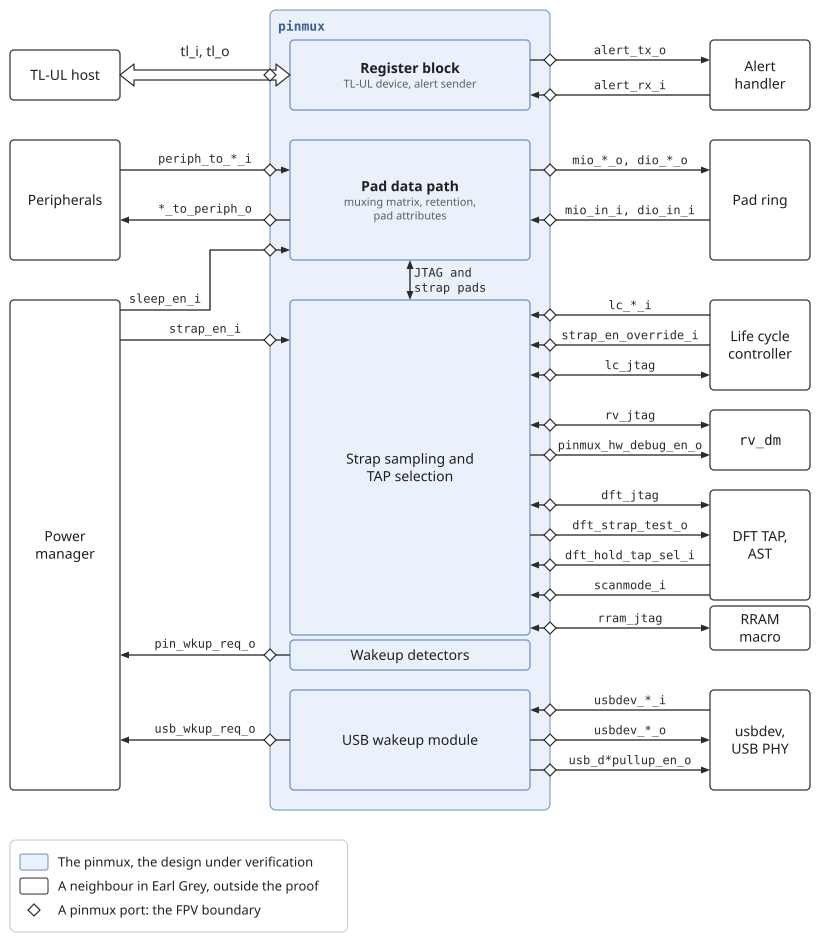
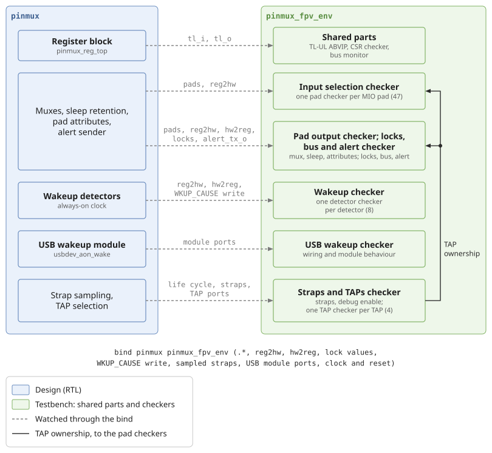

# Pinmux FPV testplan

This page is the plan of a new pinmux FPV environment for Earl Grey.
The environment proves the pinmux requirements for every pad, select value and register setting; [Scope](#scope) lists what it leaves out.
Every assertion traces to a requirement, and every requirement names its source.

## Why a new environment
The pinmux has an FPV testbench, which the [pinmux DV document](../dv/README.md) describes.
This environment is designed to take its place.
This plan leaves the existing testbench as it is.
It is a new environment rather than an extension of the existing one, for these reasons:

* **One check per rule.**
  The existing testbench holds all its assertions in one module.
  Here each feature has its own checker and each rule its own check, so a change to one rule of the specification changes one check and leaves the others as they are.
* **One copy per pad.**
  The existing assertions cover all pads through a symbolic index: one assertion whose pad number the formal tool may pick freely.
  Here the assertions are repeated per pad, lock, detector and TAP, each copy with its own cover, so a case that one pad can never reach shows up, and a failure names the pad.
* **A source for every check.**
  The existing testplan describes each assertion.
  Here each check comes from a numbered requirement that names its source, so a reviewer can hold a check against the text it comes from.
* **The registers hardware writes.**
  The CSR checker reggen generates leaves them out; this plan extends it to cover them ([CSR checker](#csr-checker)).
* **Earl Grey 2.**
  The second Earl Grey chip brings changes to the pinmux.
  With one check per rule, and the pin configuration taken as parameters, a change to the pinmux is a change to the checks of that rule only ([Earl Grey 2](#earl-grey-2)).

## The pinmux in Earl Grey
The pinmux connects the chip's peripherals to its pads.
A muxed pad (MIO) carries the peripheral signal software selects for it; a dedicated pad (DIO) is wired to one peripheral signal.
Software chooses the connections, and each pad's attributes such as a pull-up or an inversion, by writing the pinmux registers over TL-UL.
The pinmux also does these jobs with its neighbours:

* With the power manager, it holds the pad values during sleep (sleep retention), and wakes the chip when a wakeup detector sees its pattern on a pad.
* With the life cycle controller, it decides which JTAG test access port (TAP) gets the JTAG pads.
  It samples the straps, the pads that choose the TAP, at boot or in every cycle, as the life cycle state says, and connects that TAP only while life cycle allows it.
  The permission for the debug TAP is taken at boot and held: the latched debug enable.
* For usbdev, it holds the USB wakeup module, because the pinmux stays powered in sleep and usbdev does not.
* To the alert handler, it reports a fatal bus fault.

The environment sits at the pinmux's own ports: it drives every input and checks every output, and no neighbour is part of the proof.
The table lists the ports per neighbour, with the clocks and resets, which the figure leaves out.
An input marked free can take any value in any cycle.

| Neighbour | Ports: pinmux inputs; outputs and TAP ports | In the environment |
|---|---|---|
| Peripherals | `periph_to_mio_i`, `periph_to_mio_oe_i`, `periph_to_dio_i`, `periph_to_dio_oe_i`; `mio_to_periph_o`, `dio_to_periph_o` | Peripheral outputs free; the inputs the peripherals read checked |
| Pad ring | `mio_in_i`, `dio_in_i`; `mio_out_o`, `mio_oe_o`, `mio_attr_o`, `dio_out_o`, `dio_oe_o`, `dio_attr_o` | Pad inputs free; pad outputs and attributes checked |
| TL-UL host | `tl_i`; `tl_o` | Host rules assumed; responses checked |
| Alert handler | `alert_rx_i`; `alert_tx_o` | Handler rules assumed; the fatal alert checked |
| Power manager | `sleep_en_i`, `strap_en_i`; `pin_wkup_req_o`, `usb_wkup_req_o` | Sleep input and strap pulse assumed; wakeup requests checked |
| Life cycle controller | `lc_dft_en_i`, `lc_hw_debug_en_i`, `lc_hw_debug_clr_i`, `lc_escalate_en_i`, `lc_check_byp_en_i`, `lc_nvm_debug_en_i`, `strap_en_override_i`; `lc_jtag` | The life cycle signals free, any 4-bit value; `strap_en_override_i` free; the TAP port checked |
| `rv_dm` | `rv_jtag`; `pinmux_hw_debug_en_o` | TAP responses free; TAP requests and the latched debug enable checked |
| DFT and AST | `scanmode_i`, `dft_hold_tap_sel_i`; `dft_jtag`, `dft_strap_test_o` | Scan mode free, held off in a few checks only ([Assumptions](#assumptions)); the DFT TAP port and the sampled DFT straps checked |
| RRAM macro | `rram_jtag` | TAP responses free; TAP requests checked |
| usbdev and the USB PHY | the `usbdev_*` ports; `usb_dppullup_en_o`, `usb_dnpullup_en_o` | usbdev's signals and the USB lines free, with one assumption on the pull-up enables ([Assumptions](#assumptions)); the USB wakeup module's wiring and behaviour checked |
| Clock and reset managers | `clk_i`, `clk_aon_i`, `rst_ni`, `rst_aon_ni`, `rst_sys_ni` | Fixed clock ratio and one reset at the start ([Constraints](#constraints)) |

## How the plan fits together
The plan is a chain of four parts.
Each part points to the next, so a specification section leads to the assertions that check it, and a failing assertion leads back to the specification text.

1. **Specification.**
   The documents that say what the pinmux must do: [Sources](#sources) lists them.
2. **Requirements** ([requirements.md](requirements.md)).
   237 statements of what the pinmux must do, one group per feature.
   Each requirement names its source.
3. **Testpoints** ([testplan](../../data/pinmux_env_fpv_testplan.hjson)).
   27 entries of the testplan.
   The testplan also imports the one testpoint of reggen's CSR checker, `fpv_csr_rw`, so its page shows one more.
   A testpoint is one behaviour of a feature that must be shown to hold, written as one sentence, with the requirements it covers.
   A testpoint is not a module of the testbench: the module that proves it is a checker, and one checker proves one or more testpoints ([Feature checkers](#feature-checkers)).
4. **Checks.**
   137 checks, the rows of the testpoints' check tables.
   A check is a sentence that says what must hold.
   116 of them have a planned assertion of their own to prove, named `assert_<Testpoint>_<Check>`; [Check kinds](#check-kinds) says what the others are.
   A testpoint lists its checks, and a requirement names what decides it and why: its checks, the CSR checker or another testbench.

Two more words describe the testbench.
A checker is a module that holds the assertions of one feature, or of a few related ones ([Feature checkers](#feature-checkers)).
A proof is one run of the formal tool on the assertions of one checker, or of a part of them ([Proofs](#proofs)).

### One example through the chain
| Step | Example |
|---|---|
| Specification | [`MIO_PERIPH_INSEL.IN`](../registers.md#mio_periph_insel); [top_earlgrey_pinmux.ipconfig.hjson `n_mio_pads`](../../data/top_earlgrey_pinmux.ipconfig.hjson) |
| Requirement | [REQ_IN_03](requirements.md#req_in_03): MIO peripheral input `n` shall read the input of MIO pad `p`, in the same cycle, while `MIO_PERIPH_INSEL_n` is 2 + `p` (`p` from 0 to 46). |
| Testpoint | [`pad_listen`](../../data/pinmux_env_fpv_testplan.hjson#pad_listen): every peripheral input reads what its select names. It covers [REQ_IN_01](requirements.md#req_in_01), [REQ_IN_02](requirements.md#req_in_02), [REQ_IN_03](requirements.md#req_in_03), [REQ_IN_04](requirements.md#req_in_04), [REQ_IN_05](requirements.md#req_in_05). |
| Checker | The input selection checker, the module that holds the assertions of `pad_listen` |
| Check | *reads selected pad*, one of the 5 checks of `pad_listen` (*reads tie 0*, *reads tie 1*, *reads selected pad*, *no pad reads 0*, *DIO reads its pad*) |
| Planned assertion | `assert_PadListen_ReadsSelectedPad` |
| Why the check proves the requirement | For each select from 2 to 48 the check compares the input with `mio_in_i` of pad select minus 2, in the same cycle. |

### Sources
Each requirement names its source: a section, register or configuration key of the documents below, or, for a rule none of them states, that they are silent.

| Source | Documents | What the plan takes from them |
|---|---|---|
| The pinmux specification | [theory of operation](../theory_of_operation.md), [programmer's guide](../programmers_guide.md), [interfaces](../interfaces.md), [registers](../registers.md), [register description](../../data/pinmux.hjson) | The rules of every feature and register |
| The top | [top description](../../../../data/top_earlgrey.hjson), [pinmux configuration](../../data/top_earlgrey_pinmux.ipconfig.hjson), [top-level design document](../../../../../top_earlgrey/doc/design/README.md) | The pads and their types, the pad reset attributes, the strap and JTAG pads, the counts and select ranges, the clocks and resets |
| The neighbours | [power manager](../../../pwrmgr/doc/theory_of_operation.md), [reset manager](../../../rstmgr/doc/theory_of_operation.md), [alert handler](../../../../../top_earlgrey/ip_autogen/alert_handler/doc/theory_of_operation.md), [life cycle controller](../../../../../ip/lc_ctrl/doc/theory_of_operation.md), [life cycle interfaces](../../../../../ip/lc_ctrl/doc/interfaces.md), [life cycle programmer's guide](../../../../../ip/lc_ctrl/doc/programmers_guide.md), [life cycle description](../../../../../ip/lc_ctrl/data/lc_ctrl.hjson), [device life cycle specification](../../../../../../doc/security/specs/device_life_cycle/README.md), [`rv_dm` interfaces](../../../../../ip/rv_dm/doc/interfaces.md), [usbdev](../../../../../ip/usbdev/doc/theory_of_operation.md), [usbdev interfaces](../../../../../ip/usbdev/doc/interfaces.md), [usbdev wake and resume](../../../../../ip/usbdev/doc/wake_resume.md), [usbdev register description](../../../../../ip/usbdev/data/usbdev.hjson) | What each neighbour sends the pinmux and expects back |
| Common rules | [comportability](../../../../../../doc/contributing/hw/comportability/README.md), [TL-UL](../../../../../ip/tlul/README.md), the TileLink specification 1.9.3, [reggen](../../../../../../util/reggen/README.md), [CIP library](../../../../../dv/sv/cip_lib/README.md) | Bus answers, register behaviour and alerts |
| Existing testplans | [pinmux FPV testplan](../../data/pinmux_fpv_testplan.hjson), [chip testplan](../../../../../top_earlgrey/data/chip_testplan.hjson), [usbdev testplan](../../../../../ip/usbdev/data/usbdev_testplan.hjson), [chip usbdev testplan](../../../../../top_earlgrey/data/ip/chip_usbdev_testplan.hjson) | A rule no document states and an existing testplan describes |

### Check kinds
The testplan gives each check a kind:

| Kind | What it says |
|---|---|
| `forward` | When the cause happens, the design responds, and in time. |
| `backward` | The design responds only when the cause happened. |
| `both` | The output equals its expected value in every cycle, which covers both directions. |
| `legal` | The output stays inside its allowed values. |
| `stable` | The output does not change without its cause. |
| `structure` | No assertion: a check of the design's structure, named `check_<Testpoint>_<Check>`. It lists the reset of each flop of a named part, or the signals that can reach it, and fails on one its requirement does not allow ([Reset structure checks](#reset-structure-checks)). |
| `none: out of scope` | No assertion: the check is outside formal, and its requirement says why. |
| `waits on a specification question` | The assertion is named, but decides nothing while the question is open. |

## Scope
### Checked in this environment
| What | Checked by |
|---|---|
| Pad input selection | The input selection checker |
| Pad output selection, sleep retention and pad attributes | The pad output checker |
| Attribute locks, bus error handling and the fatal alert | The locks, bus and alert checker |
| The wakeup detectors | The wakeup checker |
| The USB wakeup module: its wiring, and what it does at its ports | The USB wakeup checker |
| Strap sampling, the latched debug enable and TAP selection, the RRAM TAP included | The straps and TAPs checker |
| Register access rules: access type, reset value, lock and error causes | The CSR checker |
| The TL-UL protocol on the register bus | The TL-UL ABVIP |

[Testbench architecture](#testbench-architecture) describes each of these parts.
The checks on the fatal alert, strap sampling, the latched debug enable and TAP selection check the behaviour behind the pinmux's security countermeasures.
The countermeasure testplan is [`pinmux_sec_cm_testplan.hjson`](../../data/pinmux_sec_cm_testplan.hjson).

The table names, per countermeasure of the register description, the testpoints whose requirements are on its signal.
`INTERSIG.MUBI` marks a signal between blocks that is multi-bit encoded, so that it counts as On only at one exact value.

| Countermeasure | Testpoints |
|---|---|
| `BUS.INTEGRITY` | `bus`, `alert` |
| `LC_DFT_EN.INTERSIG.MUBI` | `strap`, `dft_strap`, `jtag` |
| `LC_HW_DEBUG_EN.INTERSIG.MUBI` | `strap`, `latch`, `jtag` |
| `LC_HW_DEBUG_CLR.INTERSIG.MUBI`, `LC_CHECK_BYP_EN.INTERSIG.MUBI`, `LC_ESCALATE_EN.INTERSIG.MUBI` | `latch` |
| `PINMUX_HW_DEBUG_EN.INTERSIG.MUBI` | `latch`, `jtag` |
| `TAP.MUX.LC_GATED` | `jtag`, `jtag_pad` |
| `LC_NVM_DEBUG_EN.INTERSIG.MUBI` | `rram_tap` |

### Out of scope
* **The TL-UL integrity functions.** The environment computes the codes it expects with the same functions the design uses, so it checks that the pinmux rejects a wrong code and raises its alert, not that the functions are right.
* **Scan mode in two cases.** What a wakeup detector watches on a scan clock pad, and which reset a connected TAP's TRST_N follows: no specification says.
* **A reset during a run.** Each reset is applied once, at the start ([Constraints](#constraints)); which flops a reset reaches is checked on the design's structure.
* **A JTAG pad a TAP owns.** What a peripheral reads from it, and what it carries in sleep mode: no specification says.
* **The pad wrappers.** They sit outside the pinmux.
* **Other tops.** The requirements were read against Earl Grey only; other tops render the plan with their own parameters.

## Testbench architecture
This is the planned architecture.
The formal top is the whole `pinmux`, with its real register block and Earl Grey's pad configuration (pad types and pad roles).
One environment module, `pinmux_fpv_env`, is bound into it: attached to the design without changing it.
The environment sees every pinmux port and a few internal signals:

* the register values (`reg2hw`, `hw2reg`) and every lock register;
* the always-on side's write of `WKUP_CAUSE` and the sampled TAP straps;
* the ports, clock and reset of the USB wakeup module.

The environment has three shared parts, described first, and the feature checkers.

### TL-UL ABVIP
A set of TL-UL protocol assertions for formal (an assertion verification IP, `tlul_abvip`), new with this environment.
It assumes the host's protocol rules on `tl_i` and asserts the device's protocol rules on `tl_o`.
One instance sits on the pinmux's bus port in every checker proof, and one inside the CSR checker, in the register block proof.

### CSR checker
The CSR checker proves the register block: every register's access type, reset value and lock, and every error cause.
It keeps a mirror, its own copy of every register field.
The mirror follows each write software makes over the bus and each write hardware makes, so the checker knows what every field holds and what every read returns, whichever side wrote last.

Two kinds of pinmux register need a rule beyond the mirror, and the checker has one for each:

* **The pad attribute registers** are held outside the register block (`hwext`): the pinmux logic supplies the value of every read.
  The checker checks that a write reaches the pinmux logic in the cycle it is accepted, and that a read returns the value the logic supplies in that cycle.
  What that value must be is the `pad_attr` checks'.
* **The wakeup detector registers** cross to the always-on clock (`async`).
  The checker checks that a bus access to such a register is answered only once the write before it has reached the always-on side.
  That each write reaches the always-on logic, in time and in order, is the `wakeup_sync` checks'.

reggen already generates a CSR checker from the register description.
That checker covers only the registers hardware cannot write, and only one error cause: a request to an address no register maps.
In the pinmux it therefore leaves out the pad attribute, sleep status and wakeup cause registers, which hardware writes.
The CSR checker of this plan extends the generated one to cover them.
The extension is a change to reggen's generator, made and reviewed on its own; this plan depends on it.
Where a requirement's *Checked by* names the CSR checker, the extended checker decides it.
The imported testpoint `fpv_csr_rw` describes the generated checker without the extension.

### Bus monitor
The bus monitor watches the register bus.
It records each write the pinmux takes, and whether the write was answered without an error.
The lock, alert test, wakeup mode and failed-write checks read it to know what software wrote, and so does the check that the RRAM TAP stays cut until its register is written.

### Feature checkers
| Checker | What it checks | Testpoints it proves | Its assertions are repeated per |
|---|---|---|---|
| Input selection checker | The input selection of every MIO and DIO peripheral input | `pad_listen`; on Earl Grey 2 also `sparse_insel`, `eg2_matrix`, `eg2_default` | MIO pad (47) |
| Pad output checker | The output mux, sleep retention and pad attributes | `pad_output`, `pad_sleep`, `pad_attr`; on Earl Grey 2 also `sparse_outsel`, `eg2_matrix`, `eg2_default`, `eg2_attr_reset` | Pad, MIO and DIO |
| Locks, bus and alert checker | The attribute locks; the bus answers, failed requests and the fatal alert | `regwen`, `bus`, `alert`; in `bus`, the protocol check is the TL-UL ABVIP's and the two error checks follow from the CSR checker | Attribute lock (63) |
| Wakeup checker | The wakeup detectors, their cause bits and the wakeup request | `wakeup`, `wakeup_cause`, `wakeup_sync`; on Earl Grey 2 also `wkup_capable` | Detector (8) |
| USB wakeup checker | Each port of the USB wakeup module carries the pinmux signal of the same role; the module takes over the pull-ups, reports its three events and requests the wakeup as usbdev's specification says | `usb_conn`, `usb_module` | - |
| Straps and TAPs checker | Strap sampling, the DFT straps, the latched debug enable, TAP selection and the JTAG pads | `strap`, `dft_strap`, `latch`, `jtag`, `jtag_pad`, `rram_tap` | TAP (4) |

The assertions are repeated per pad, attribute lock, detector or TAP, as the last column says, so each copy is proven on its own and a failure names the pad, lock, detector or TAP it happened on.
The other locks are the CSR checker's.
Each assertion carries the name its check plans, such as `assert_PadListen_ReadsSelectedPad`, and a comment that names its requirements and its testpoint.
The testpoints `reset_state` and `sleep_release` have no assertions of their own: they follow from the checks of the testpoints above, as the testplan says for each.

### TAP ownership
While a TAP is connected, the five JTAG pads belong to that TAP and not to the pad muxes.
The straps and TAPs checker works out, per TAP, whether the TAP may own the JTAG pads now, from the sampled straps, the latched debug enable and the live DFT enable.
The input selection and pad output checkers apply their checks to the JTAG pads only while no TAP may own them.

### Reset structure checks
Most proofs apply each reset once, at the start ([Constraints](#constraints)), so a rule about what a later reset does is checked on the design's structure instead.
The checks of kind `structure` are not assertions.
The setup of the formal run lists the reset of each flop of the named part and the signals that can reach it.
It stops the run with an error when a check fails or the part has no flop.
Each check's row in the testplan names the part and the resets it allows:

* No reset that a non-debug module (NDM) reset asserts reaches the sampled TAP straps, the latched debug enable or the TAP selection, through a flop's reset or through its data (`strap`, `latch`, `jtag`).
* Every flop of the USB wakeup module takes its reset from `rst_aon_ni` (`usb_conn`).

### Where the expected values come from
A checker must not take its expected values from the design it checks, or a fault in the design would pass.
The environment takes them from the descriptions the design is generated from:

* **Register offsets and field positions**: the register order and field layout of the register description, `pinmux.hjson`.
* **Pad and peripheral counts, and pad attribute reset values**: the top's pinmux configuration, `top_earlgrey_pinmux.ipconfig.hjson`, which topgen writes from the top description.
  A fault in the RTL generated from it then shows as a failing check.
* **The JTAG and strap pads, and the pad types**: the top description, `top_earlgrey.hjson`.
* **TL-UL integrity codes**: the integrity functions of `tlul_pkg`, the one expected value the environment takes from the RTL.
  The environment also uses the RTL's port and register struct types.

## Verification strategy
Three words describe how the proofs are set up:

* An **abstraction** makes part of the design or its start state freer, so that a proof covers more cases; it loses nothing.
* A **constraint** narrows what the proofs explore; what it leaves unchecked is listed beside it.
* An **assumption** is a rule the environment's inputs follow.
  Each one names its source, and says so where no specification gives the rule.

### Proofs
The checks are proven in separate proofs.
Each proof runs on the whole design and holds the assertions its row names, with the assumptions they need.

| Proof | Checker | Testpoints | Start state and setup |
|---|---|---|---|
| Register block | CSR checker | the imported `fpv_csr_rw` | The registers start from reset |
| Input selection | Input selection checker | `pad_listen` | The register fields start from any value |
| Pad output | Pad output checker | `pad_output`, `pad_sleep`, `pad_attr` | The register fields start from any value |
| Locks, bus and alert | Locks, bus and alert checker | `regwen`, `bus`, `alert` | The registers start from reset |
| Wakeup | Wakeup checker | `wakeup`, `wakeup_cause`, `wakeup_sync` | The register fields on `clk_i` start from any value; the detector locks start from reset |
| Main off (Earl Grey 2) | The checkers above | `split_reset` | The Main section is held in reset for the whole run, as when it is powered off |
| USB wakeup | USB wakeup checker | `usb_conn`, `usb_module` | The registers start from reset |
| Strap sampling | Straps and TAPs checker | `strap`, `dft_strap` | The register fields start from any value |
| TAP selection | Straps and TAPs checker | `latch`, `jtag`, `jtag_pad`, `rram_tap` | The sampled TAP straps are free |
| Reset values | Input selection and pad output checkers | the checks of `pad_attr` and `pad_sleep` on the state right after reset | The registers start from reset |
| The design's own assertions | None: the assertions written in the RTL | - | The registers start from reset; reported apart from the checkers |

A start from any value hides the reset values, which is why the checks on the state right after reset have a proof of their own.

### Abstractions
| Abstraction | Why it is sound |
|---|---|
| The register fields start from any value. This applies to the fields only software writes; the fields hardware writes and the always-on fields start from reset. | The proof covers every setting software could have written earlier, without the tool having to find the writes. The reset values are among the start values, so no reachable state is lost. |
| The sampled TAP straps are free in the TAP selection proof. | The TAP checks then hold for every strap value in every cycle. The strap sampling proof shows that the sampled straps are right. |

### Constraints
Each constraint keeps the proofs short; what it leaves unchecked is in its last sentence.

* **`clk_aon_i` runs five times slower than `clk_i`.** The always-on clock is the slow one ([Wakeup Features](../programmers_guide.md#wakeup-features)), and the clock-crossing primitive's own assertions are written for this ratio. Checks timed in always-on cycles hold at this ratio only.
* **Each reset is applied once, at the start.** A reset in any cycle multiplies the states. Which flops a reset reaches is checked on the structure instead ([Reset structure checks](#reset-structure-checks)).
* **No signal integrity error on the alert lines.** The alert handler keeps its pairs complementary ([Assumptions](#assumptions)). The alert sender's answer to such an error is not checked.

### Assumptions
What the environment assumes about the pinmux's neighbours; every other input is free.

* **Scan mode is free, except in two cases** (`scanmode_i`). It is held off while a wakeup detector watches a scan clock pad, and for the checks that a connected TAP's TRST_N follows its pad ([Out of scope](#out-of-scope)).
* **The bus host follows TL-UL** (`tl_i`). At most one pending request per source ID. The checker proofs also send only legal requests; the register block proof does not, to reach the error causes ([TL-UL protocol checker](../../../../../ip/tlul/doc/TlulProtocolChecker.md)).
* **The alert handler follows the alert protocol** (`alert_rx_i`). Complementary pairs, the four-phase handshake and pings at least 4 cycles apart ([Differential Alert Signaling](../../../../../top_earlgrey/ip_autogen/alert_handler/doc/theory_of_operation.md#differential-alert-signaling), [LFSR Timer](../../../../../top_earlgrey/ip_autogen/alert_handler/doc/theory_of_operation.md#lfsr-timer)).
* **The sleep input changes on `clk_i`** (`sleep_en_i`). The power manager and the pinmux run on the same clock ([top_earlgrey.hjson `module.pwrmgr.clock_srcs clk_i`](../../../../data/top_earlgrey.hjson), [top_earlgrey.hjson `module.pinmux clock_srcs`](../../../../data/top_earlgrey.hjson)).
* **The strap pulse comes once per boot** (`strap_en_i`). Never after an NDM reset ([Strap Sampling and TAP Isolation](../theory_of_operation.md#strap-sampling-and-tap-isolation)); one `clk_i` cycle wide, as the design's own assumption `PwrMgrStrapSampleOnce0_A` has it.
* **A wakeup detector is off while software changes its mode** (`tl_i` writes). Its counter is not cleared on a mode change ([Wakeup Detectors](../theory_of_operation.md#wakeup-detectors)).
* **usbdev's pull-up enables are steady before a suspend request** (`usbdev_*`). They do not change in the 4 always-on cycles before it; the module takes over only in the Suspended state ([Optional external AON/Wake functionality](../../../../../ip/usbdev/doc/theory_of_operation.md#optional-external-aonwake-functionality)).

The design's own assumptions on its inputs (`PinmuxWkupStable_A`, `PwrMgrStrapSampleOnce0_A`, `PwrMgrStrapSampleOnce1_A`) are not used by the checker proofs.

### Vacuity and covers
* Every assertion has a cover that reaches its trigger under the proof's assumptions.
  An assertion whose cover is not reached proves nothing.
* Environment covers show that the assumptions do not block legal stimulus: for example a sleep entry in each sleep mode, a write after a lock closes, and an alert for each alert cause.
  A cover that cannot be reached means the environment is too tight.
* The deepest cases, a wakeup count of 255 and the counter's wrap, need about 260 always-on cycles.
  They run as bounded searches and are reported with the depth reached.

### Sign-off criteria per stage
The stages are OpenTitan's [verification stages for FPV](../../../../../../doc/project_governance/development_stages.md).
A requirement closes when its checks are proven and their covers reached.
The proofs its checks rely on must be proven, and each constraint of its proof lifted or recorded.

| Stage | OpenTitan's main criteria (the full list: verification stages for FPV) | In this plan |
|---|---|---|
| V1 | Testplan completed and reviewed; the design bound to the assertion modules, with the interface assertion monitors hooked up; known-value assertions on the outputs; the assertions of the main functional path implemented and passing; each input and output part of at least one assertion; a regression set up. | `pad_listen` and `pad_output`: the pad data path, which is the pinmux's main functional path. The TL-UL ABVIP bound. |
| V2 | This document complete; all functional assertions written and enabled; the assumptions specified and reviewed; 90 % of the properties proven; 90 % code coverage and 75 % cone-of-influence coverage. | Every other functional testpoint and the CSR checker; the TL-UL ABVIP's device rules proven. The plan's own coverage targets: 90 % code coverage and 100 % cone-of-influence coverage, the share of the design's code that can affect at least one assertion. |
| V2S | All checks of the security countermeasures passing. | The testpoints of the fatal alert, strap sampling, the latched debug enable and TAP selection. |
| V3 | All assertions proven, with reviewed assumptions; 100 % code and cone-of-influence coverage. | Every testpoint. |

## Earl Grey 2
Earl Grey in this repository is the second Earl Grey chip: its top description gives the life cycle controller the Earl Grey 2 product ID.
Its pinmux changes are below; each has requirements and checks of its own, most in the [Earl Grey 2](requirements.md#earl-grey-2) group:

| Change | What it does | Testpoints |
|---|---|---|
| A second GPIO module | `gpio0` and `gpio1` give each pad a GPIO input of its own, as one module has only 32. | The selection testpoints, over the peripheral counts of the top's configuration |
| Sparse muxing | The top lists the pads each peripheral input may read and the outputs each pad may drive, with a default that is the select's reset value. A select off the list gives an input 0 and leaves a pad high-Z. | `sparse_insel`, `sparse_outsel`, `eg2_matrix`, `eg2_default` |
| Wakeup-capable pads | The top marks the pads a wakeup detector may watch; any other pad reads 0 to the detector. | `wkup_capable` |
| Two power domains | The selects and muxes that deep sleep does not need move to the Main power domain and reset with it. JTAG muxing, strap sampling, the wakeup detectors and pad retention stay always-on. | `split_reset` |
| Pad attribute reset values set by the top | Each pad starts with the attributes its top entry gives. | `pad_attr`, `eg2_attr_reset` |
| The RRAM TAP | A fourth TAP, for the RRAM, selected by software and life cycle. | `rram_tap` |

A count, a pad list or a reset value is a parameter the checkers take from the top's configuration ([Where the expected values come from](#where-the-expected-values-come-from)).
A later change enters the plan the same way: a new rule is a new requirement with its own check.

## Building and running tests
The environment's [dvsim](https://github.com/lowRISC/dvsim) entry is `pinmux_env_fpv`, in the formal configuration of Earl Grey.

## Requirements
[requirements.md](requirements.md) holds the 237 requirements, for reading.
[`pinmux_fpv_requirements.hjson`](../../data/pinmux_fpv_requirements.hjson) holds the same rows as data.
228 of them state a rule the specification gives (kind `spec`).
9 state a rule no specification gives (kind `RTL`); they follow the design's present behaviour.

## Testplan
[Testplan](../../data/pinmux_env_fpv_testplan.hjson)
