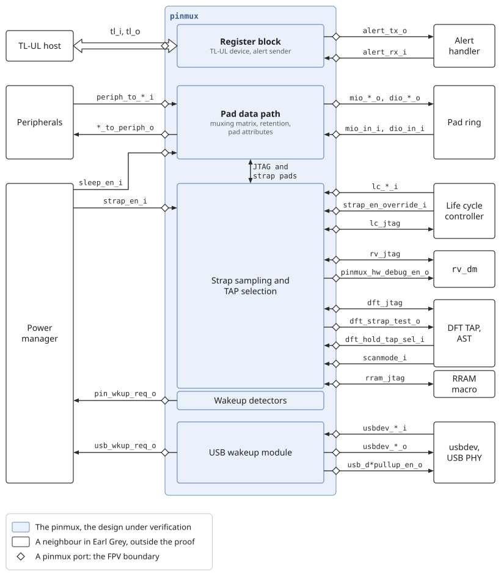
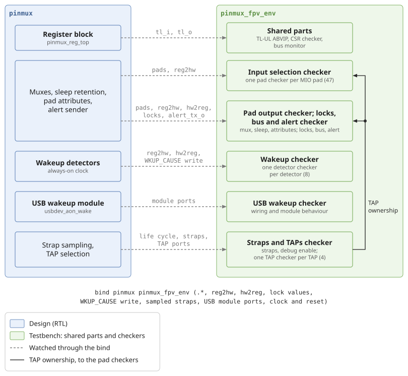

# Pinmux FPV plan

## Goals
* **FPV**
  * Prove that every output of the English Breakfast pinmux does what the pinmux specification says, for every pad, select value and register setting at once.
  * Trace every check to a requirement, and every requirement to the specification text it comes from.

This document is the plan of a new pinmux FPV environment, and the planning is complete: the requirements, the testplan and the testbench architecture.
Nothing of the environment is implemented in this change; each check names the assertion planned for it.
The environment will add the functional checks.
It will replace neither the existing pinmux FPV testbench ([pinmux DV document](../dv/README.md)) nor the generated register checks.

This page is rendered for this top from the pinmux template by `make -C hw top`.
The plan was written and reviewed for Earl Grey only: no requirement has been read against this top's specification, so every requirement is open.

## Current status
* [Design & verification stage](../../../../../README.md)
  * [HW development stages](../../../../../../doc/project_governance/development_stages.md)

## Design features
For detailed information on pinmux design features, please see the [pinmux design specification](../../README.md).

## How the plan fits together
1. **Specification.**
   The English Breakfast pinmux documents (theory of operation, programmer's guide, interfaces, register description), and the documents of the blocks it talks to (life cycle controller, power manager, usbdev, TL-UL).
   A document is cited by its section and a register by its name and field (`!!REG.FIELD` in Hjson).
   A value that depends on the top's configuration, such as a pad count, a select range, the JTAG and strap pads, a pad type or a reset tree, cites the configuration that sets it: `top_englishbreakfast_pinmux.ipconfig.hjson` or `top_englishbreakfast.hjson`.
   The plan was checked against the Earl Grey specification at commit [`5b8df2b85493add710eb5b8af7d6c263ce9acb87`](https://github.com/lowRISC/opentitan/blob/5b8df2b85493add710eb5b8af7d6c263ce9acb87).
2. **Requirements** ([requirements.md](requirements.md), [`pinmux_fpv_requirements.hjson`](../../data/pinmux_fpv_requirements.hjson)).
   192 testable statements of what the pinmux must do, in groups, one group per feature.
   Each requirement gives its specification references, its kind, its testpoint, the checks that decide it and why those checks prove it.
   Each group lists the conditions its requirements hold under, such as scan mode being off.
3. **Testpoints** ([`pinmux_env_fpv_testplan.hjson`](../../data/pinmux_env_fpv_testplan.hjson)).
   20 testpoints, each with one rule, a stage and a priority.
   A testpoint lists the requirements it closes under `features`, and each requirement belongs to exactly one testpoint.
   Its description holds a table of its checks, each with its kind and the requirements it decides.
4. **Checks.**
   95 named checks, each stating what one assertion must assert, with the label planned for that assertion (`assert_<Testpoint>_<Check>`).
   A testpoint lists no test yet: the tests are added with the environment.
   A check decides a requirement in one direction: forward, the design responds when the rule says so, within the rule's bound; or backward, the design responds only then.
   An equality between an output and its expected value decides both directions (kind `both`, or `equality` where a table gives no kind).
   A `legal` check holds an output inside its allowed values, and a `stable` check forbids a change without its cause.
   A check of kind `none` is out of scope for formal and gets no assertion; its requirement says which method covers it, or that none does yet.
   A check that waits on a specification question is written once the question is answered.

The chain reads in both directions: from a specification section to the requirements that cite it, their testpoint and their checks, and from a failing check back to the specification text it checks.
One requirement, end to end:

| Step | Where it is written | For `REQ_IN_01` |
|---|---|---|
| Specification | the requirement's `source` | [`MIO_PERIPH_INSEL.IN`](../registers.md#mio_periph_insel) |
| Requirement | [requirements.md](requirements.md#input-selection), `pinmux_fpv_requirements.hjson` | MIO peripheral input `n` shall read 0 while `MIO_PERIPH_INSEL_n` is 0. |
| Testpoint | the testpoint's `features`, the requirement's `testpoint` | `pad_listen` (V1, priority 1) |
| Check | the check table in the testpoint's description, the requirement's `checks` | `pad_listen`: *reads tie 0* |
| Why the check proves it | the requirement's `why` | In every cycle the check compares each MIO peripheral input whose select is 0 with 0. An input that reads a pad or 1 under select 0, even for one cycle, fails it. |
| Planned assertion | the check table in the testpoint's description | `assert_PadListen_ReadsTie0` |

## The pinmux in English Breakfast
The pinmux sits between the peripherals and the pad ring.
Software sets it up through its register block, a TL-UL device.
Besides the pad data path, the pinmux works with the power manager (sleep, wakeup and the strap sampling pulse), the life cycle controller (the signals that allow debug and test access), the TAPs it connects to the JTAG pads, usbdev (whose wakeup module it holds, so that the module stays powered in sleep) and the alert handler.

The FPV boundary is the pinmux's own ports: the environment will drive every input and observe every output, and no neighbour is part of the proof.
The figure leaves out the clocks and resets; the table lists them.

| Neighbour | Ports: pinmux inputs; outputs and TAP ports | In the planned environment |
|---|---|---|
| Peripherals | `periph_to_mio_i`, `periph_to_mio_oe_i`, `periph_to_dio_i`, `periph_to_dio_oe_i`; `mio_to_periph_o`, `dio_to_periph_o` | Peripheral outputs free; the inputs the peripherals read checked |
| Pad ring | `mio_in_i`, `dio_in_i`; `mio_out_o`, `mio_oe_o`, `mio_attr_o`, `dio_out_o`, `dio_oe_o`, `dio_attr_o` | Pad inputs free; pad outputs and attributes checked |
| TL-UL host | `tl_i`; `tl_o` | Host rules assumed; responses checked |
| Alert handler | `alert_rx_i`; `alert_tx_o` | Handler rules assumed; the fatal alert checked |
| Power manager | `sleep_en_i`, `strap_en_i`; `pin_wkup_req_o`, `usb_wkup_req_o` | Sleep input and strap pulse assumed; wakeup requests checked |
| Life cycle controller | `lc_dft_en_i`, `lc_hw_debug_en_i`, `lc_hw_debug_clr_i`, `lc_escalate_en_i`, `lc_check_byp_en_i`, `strap_en_override_i`; `lc_jtag` | Free, any 4-bit value; the TAP port checked |
| `rv_dm` | `rv_jtag`; `pinmux_hw_debug_en_o` | TAP responses free; TAP requests and the latched debug enable checked |
| DFT and AST | `scanmode_i`, `dft_hold_tap_sel_i`; `dft_jtag`, `dft_strap_test_o` | Scan mode assumed; the DFT TAP port and the sampled DFT straps checked |
| usbdev and the USB PHY | the `usbdev_*` ports; `usb_dppullup_en_o`, `usb_dnpullup_en_o` | usbdev's signals free; the USB wakeup module's wiring checked |
| Clock and reset managers | `clk_i`, `clk_aon_i`, `rst_ni`, `rst_aon_ni`, `rst_sys_ni` | Fixed clock ratio and one reset at the start ([Restrictions](#restrictions)) |

## Scope
Covered here:
* Pad input and output selection, sleep retention and pad attributes.
* Register locks, bus error handling and the fatal alert.
* The wakeup detectors and the USB wakeup wiring.
* Strap sampling, the latched debug enable and TAP selection.

Covered elsewhere:
* Register access rules: the generated CSR checker (imported testplan), in the extended form this plan needs ([Testbench architecture](#testbench-architecture)).
* Countermeasures: [`pinmux_sec_cm_testplan.hjson`](../../data/pinmux_sec_cm_testplan.hjson).
* The USB wakeup module's own logic: the usbdev testbench.
* The TL-UL integrity encoders: the `prim_secded_inv_64_57` and `prim_secded_inv_39_32` FPV testbenches.
* Scan mode beyond the checks that name it: DFT.

Not covered: the pad wrappers and resets after the start of a run ([Restrictions](#restrictions)).

## Testbench architecture
This is the planned architecture; none of its files exists yet.
The formal top is `pinmux`, elaborated whole, with the real register block and English Breakfast's target configuration (pad types and pad roles).
One environment, `pinmux_fpv_env`, planned under `fpv/env/` of the pinmux template, is bound into it.
It takes every pinmux port as an input, and reads a few internal signals by path: the register block's `reg2hw` and `hw2reg`, the value of every lock register, the always-on side's write of `WKUP_CAUSE`, the sampled TAP straps, and the USB wakeup module's ports, clock and reset.
Inside it, one harness per checker holds that checker's environment rules, models and properties.

| Part | Planned files | What it does |
|---|---|---|
| Bind, top and core | `pinmux_fpv_env_bind.sv.tpl`, `pinmux_fpv_env.sv.tpl`, `pinmux_env_fpv.core.tpl` | The bind into `pinmux`; the top, which holds the TL-UL ABVIP, the write record, the harnesses and the USB wiring checks; the FuseSoC core `lowrisc:englishbreakfast_fpv:pinmux_env_fpv` |
| TL-UL ABVIP (`u_tl`) | a TL-UL assertion VIP, planned under `hw/dv/sv/tlul_abvip/` | Assumes the host's rules on `tl_i` and asserts the device's rules on `tl_o` |
| Generated CSR checker | an extension of the CSR assertions reggen generates (`util/reggen`), planned with the environment | Every register's access type, reset value and lock, and every error cause of the register block; the checker at this commit covers only the registers hardware does not write and the error for an address no register maps |
| Write record | in the top | Each write the ABVIP sees taken, and whether it was answered without an error; the lock, alert test, wakeup mode and failed-write checks read it |
| Register map | `pinmux_fpv_regmap_pkg.sv` | The register offsets and field positions, computed from the register order and field layout of `pinmux.hjson` and the instance's counts; it takes only the `reg2hw` and `hw2reg` types from the RTL |
| Input selection harness (`u_listen`) | `pinmux_listen_harness.sv`, `pad_listen_chk.sv` (one per MIO pad, 47) | The input selection of every MIO and DIO peripheral input |
| Pad output harness (`u_output`) | `pinmux_output_harness.sv`, `regwen_chk.sv` (one per attribute lock, 61) | The output mux, sleep retention and pad attributes; the attribute locks; the bus answers, failed requests and the fatal alert |
| Wakeup harness (`u_wakeup`) | `pinmux_wakeup_harness.sv`, `wkup_detector_chk.sv` (one per detector, 8) | The wakeup detectors, their cause bits and the wakeup request |
| USB wiring | in the top | Each port of the USB wakeup module carries the pinmux signal of the same role |
| Straps and TAPs harness (`u_jtag`) | `pinmux_jtag_harness.sv`, `jtag_tap_chk.sv` (one per TAP, 3) | Strap sampling, the DFT straps, the latched debug enable, TAP selection and the JTAG pads |

Where a requirement or a check names the generated register checker, it means that checker in its extended form.

The harnesses share these constructions:
* **TAP ownership.**
  The straps and TAPs harness computes, per TAP, whether that TAP may own the JTAG pads now, from the sampled straps, the latched debug enable and the live DFT enable.
  The input selection and pad output harnesses apply their checks on the five JTAG pads only while no TAP may own them.
* **Integrity reference.**
  The expected response and data integrity codes come from the TL-UL integrity functions of `tlul_pkg` (`get_cmd_intg`, `get_rsp_intg`, `get_data_intg`), the one block-level definition the environment takes from the RTL.
* **Pin matrix.**
  The pad and peripheral counts and the pad roles come from the pinmux parameters topgen writes from the top description, never from the rendered RTL, so an error in the generated RTL shows as a failing check.

Every pad, lock, detector and TAP has its own checker instance in a generate loop, so no check uses a symbolic index.
Each property carries the label its check plans, such as `assert_PadListen_ReadsTie0`, and a comment that names the requirements it decides and its testpoint.

## Verification strategy
The proof is planned as separate proof tasks.
A task is a proof context that copies one checker's properties and environment rules, never the design's own assertions; those are proven in a task of their own.
Every task elaborates the whole design, and every task runs with the sleep input on `clk_i` ([Environment assumptions](#environment-assumptions)).

### Proof tasks
| Task | Proves (testpoints) | Abstraction or cut | Environment assumptions |
|---|---|---|---|
| `task_Csr_Main` | the register block's own rules, by the generated CSR checker in its extended form (the imported `fpv_csr_rw` testpoint) | none: the registers start from reset | the CSR checker's own |
| `task_PadInput_Main` | `pad_listen` | init-value abstraction | scan mode, bus host, strap pulse |
| `task_PadOutput_Main` | `pad_output`, `pad_sleep`, `pad_attr` | init-value abstraction | scan mode, bus host, strap pulse |
| `task_SelDefault_Main` | each select's reset value in the first cycle after a reset (`reset_state`); the first cycle of the sleep status rule (`pad_sleep`) | none, since the abstraction would free the reset values | bus host |
| `task_RegLock_Main` | `regwen`, `bus`, `alert` | none | bus host, alert handler |
| `task_Wakeup_Main` | `wakeup`, `wakeup_cause`, `wakeup_sync` | init-value abstraction on the `clk_i` fields; the detector locks start at reset | scan mode, bus host, detector mode change |
| `task_UsbConn_Main` | `usb_conn` | USB wakeup module blackboxed | bus host |
| `task_JtagStrap_Main` | `strap`, `dft_strap` | init-value abstraction | bus host, strap pulse |
| `task_JtagTap_Main` | `latch`; from `jtag`, the TCK, TMS and TDI of a connected TAP in either mode, and the TAP reset in scan mode | sampled TAP straps cut | bus host, strap pulse; scan mode free |
| `task_JtagTap_MissionMode` | `jtag` and `jtag_pad` with scan mode off | sampled TAP straps cut | scan mode, bus host, strap pulse |
| `task_Design_Main` | the design's own assertions, reported apart from the checkers | none | bus host, strap pulse |

The straps and TAPs checker has three tasks.
`task_JtagTap_Main` cuts the sampled straps, so the latch and TAP checks hold for every strap value in every cycle; the strap checks observe the strap flops themselves, so they stay in `task_JtagStrap_Main`.
`task_JtagTap_MissionMode` adds the scan mode assumption, which in `task_JtagTap_Main` would narrow the latch checks and leave the scan-mode TAP reset unreachable.

### Abstractions and cut points
| Abstraction | Tasks | Why it is sound |
|---|---|---|
| Init-value abstraction: every register field software writes and hardware does not (not `hwext`, shadowed, asynchronous or `reinit`) starts from any value; hardware-written and always-on fields start from reset | `task_PadInput_Main`, `task_PadOutput_Main`, `task_Wakeup_Main`, `task_JtagStrap_Main` | It adds start states, the reset state among them, so every reachable state stays reachable. A counterexample from a start the design would have reacted to is resolved with a proven helper, never with an assumption on the fields. |
| The wakeup detector locks (`WKUP_DETECTOR_REGWEN`) start from reset, outside the abstraction | `task_Wakeup_Main` | It loses no reachable state: a lock resets to 1, and one write of 0 closes it. |
| The USB wakeup module is blackboxed | `task_UsbConn_Main` | It adds behaviour: the module's outputs are free, and the wiring checks hold for any value it drives. The module's own behaviour is usbdev's to verify. |
| The sampled TAP straps are cut | `task_JtagTap_Main`, `task_JtagTap_MissionMode` | It adds behaviour: any strap value in any cycle. `task_JtagStrap_Main` proves the sampled straps right. |

### Restrictions
Each restriction removes behaviour the specification allows, and names the requirements it limits.

| Restriction | Removes | Requirements it limits |
|---|---|---|
| `clk_aon_i` runs at a quarter of `clk_i` in every task | equal clocks and other ratios | The checks on the always-on clock hold at this ratio only: wakeup sampling and filtering (REQ_WKUP_04, REQ_WKUP_05), writes landing in the always-on logic (REQ_WKUP_19a to REQ_WKUP_19d), the USB wakeup module's clock (REQ_USB_04a), and a failed write to always-on registers (REQ_BUS_04). On the chip, the always-on clock is the slower one. |
| Every reset (`rst_ni`, `rst_aon_ni`, `rst_sys_ni`) is applied once at the start of a run and then held released | a reset during a run: a non-debug module (NDM) reset, a full reset | The requirements only such a reset shows are not covered by formal: straps kept over an NDM reset (REQ_STRAP_07), the NDM reset half of the latch hold (REQ_DBG_02), and a connected RISC-V TAP kept over an NDM reset (REQ_TAP_12), and the reset of the USB wakeup module (REQ_USB_04b). |
| The `FPV_ALERT_NO_SIGINT_ERR` define of the planned dvsim entry | the alert sender's own signal integrity assertions | None: the alert handler assumption keeps both differential pairs complementary, so no signal integrity error is stimulus. |

### Environment assumptions
What the environment assumes about the pinmux's neighbours; every other input is free.

| Assumption | Port | Rule | Why it is needed | Basis |
|---|---|---|---|---|
| Scan mode | `scanmode_i` | Scan mode is not True. `task_JtagTap_Main` leaves it free, so that the TAP checks that name scan mode reach it. | In scan mode the pads serve the scan chains, and scan is verified by DFT. | [Generic Pad Wrapper](../theory_of_operation.md#generic-pad-wrapper): "certain pad attributes and functionalities need to be bypassed" |
| Bus host | `tl_i` | The host keeps the TL-UL handshake, holding a request until the pinmux takes it, and keeps at most one request pending per source ID. The integrity codes stay free. | A request no host sends fails the bus checks on a correct design. | [TL-UL protocol checker](../../../../../ip/tlul/doc/TlulProtocolChecker.md) |
| Alert handler | `alert_rx_i` | Outside its in-band reset, the handler keeps its acknowledge and ping pairs complementary, acknowledges an alert only through the four-phase handshake, answers each phase within a bounded number of `clk_i` cycles, and sends pings at least 4 cycles apart. | A receiver no alert handler can be makes a correct alert sender fail. | [Differential Alert Signaling](../../../../../top_earlgrey/ip_autogen/alert_handler/doc/theory_of_operation.md#differential-alert-signaling) |
| Sleep input clock | `sleep_en_i` | The input changes only on edges of `clk_i`. | The pinmux uses it on `clk_i`; an input on another clock needs a synchronizer that a single-clock model cannot see. | No specification names the clock of this signal; the description of this top was not read. |
| Strap pulse | `strap_en_i` | The power manager raises the input for one `clk_i` cycle, at most once between two full resets, and never after an NDM reset. | A pulse after an NDM reset would sample the debug enable again while the life cycle controller is in reset, and cut a live debug session. | [Strap Sampling and TAP Isolation](../theory_of_operation.md#strap-sampling-and-tap-isolation): "This pulse is asserted once during boot (and not after an NDM reset)." |
| Detector mode change | `tl_i` writes | Software turns a wakeup detector off before it changes the detector's mode; every other detector field may change at any time. | A mode change while the detector is enabled leaves the pulse counter part way, with a result the specification does not define. | [Wakeup Detectors](../theory_of_operation.md#wakeup-detectors): the counter "is NOT cleared upon a mode change" |

Free: every pad input; every peripheral output and output enable; every value software can write, at any time and in any order, except a detector's mode while it is enabled; the request integrity codes; the life cycle inputs, any 4-bit value; the TAP responses; and usbdev's signals to the USB wakeup module.
Every check is a safety property, so the environment needs no rule that the host eventually takes each response.

### Assume-guarantee between tasks and plans
A task relies on facts that another task or another plan proves.
No pinmux task assumes them: each is a premise of the checks that use it, and no premise depends on another.

| Premise | Proven in | Used by |
|---|---|---|
| The sampled TAP straps and the latched debug enable are right | `task_JtagStrap_Main`, `task_JtagTap_Main` | The TAP selection checks, which start at the cut straps; the TAP ownership guard of the input selection and pad output harnesses |
| The register block follows its access types and reset values, honours its locks and answers by the TL-UL rules | `task_Csr_Main` | The checks composed from the register values (below) |
| The register block answers in the cycle after a request, one request at a time | `task_Csr_Main`, through the ABVIP's device rules | The ABVIP's device parameters here, which assert it again |
| The TL-UL integrity encoders compute their codes right | the `prim_secded_inv_64_57` and `prim_secded_inv_39_32` FPV testbenches | The expected integrity codes of the bus checks |
| The USB wakeup module behaves as the usbdev specification says (REQ_USB_06) | the usbdev tests `usbdev_aon_wake_resume`, `usbdev_aon_wake_reset` and `usbdev_aon_wake_disconnect` | Nothing here: this environment checks the wiring only |

These testpoints have no checks of their own:

| Testpoint | How it closes |
|---|---|
| `reset_state` | `task_SelDefault_Main` proves that each select holds its reset value in the first cycle after a reset (input 0, output 2), the CSR checker proves the register keeps it until written, and the `pad_listen` and `pad_output` checks read it. |
| `sleep_release` | The `pad_output` checks hold whenever a pad's sleep mode is not active. |
| `usb_module` | The usbdev tests above. |
| `jtag_ndm` | Not covered by formal: it needs a reset during a run ([Restrictions](#restrictions)). |

### Vacuity and covers
* Every assertion has covers that reach its trigger under its task's assumptions, so that no proof is vacuous; an assertion whose covers are not reached closes nothing.
* Environment covers show that the assumptions leave the stimulus open: each select class on every input and pad, an output enable toggling on a selected output, a sleep entry with each sleep mode and a release, an attribute write and its read-back, a lock closed and its register written after, and an alert event for each alert cause.
  An unreachable environment cover means an over-constrained environment until it is explained.
* A backward check holds a credit from the cause it allows, and the credit expires after its window, so a change long after its cause fails.
  Where the specification leaves a latency open, the check is such a window, never a free constant.
* A wakeup threshold of 255 and the counter's wrap need about 260 always-on cycles: their covers run as deep bounded searches, reported with the depth reached, and an assertion left undetermined is reported with its bound.

### Sign-off criteria per stage
The stages are OpenTitan's [verification stages for FPV](../../../../../../doc/project_governance/development_stages.md).
A requirement closes when its checks are proven, their covers are reached, every premise it uses is proven, and every restriction of its task is lifted or recorded with the requirements it limits.

| Stage | Criteria |
|---|---|
| V1 | Testplan completed and reviewed; the design bound to the assertion modules, with the interface assertion monitors hooked up; the assertions of the main functional path implemented and passing; each input and output part of at least one assertion; a regression set up. |
| V2 | This document complete; all functional assertions written and enabled; the assumptions specified and reviewed; 90 % of the properties proven; 90 % code coverage and 75 % cone-of-influence coverage. |
| V2S | All checks of the security countermeasures passing: here the fatal alert, strap sampling, the latched debug enable and TAP selection. |
| V3 | All assertions proven, with reviewed assumptions; 100 % code and cone-of-influence coverage. |

## Building and running tests
The environment will run under [dvsim](https://github.com/lowRISC/dvsim), as the entry `pinmux_env_fpv` of the formal configuration of Earl Grey.
The entry is added with the environment; it is not part of this change.

## Requirements
Rendered from [`pinmux_fpv_requirements.hjson`](../../data/pinmux_fpv_requirements.hjson).
Every requirement in full: [requirements.md](requirements.md).
Each requirement has a kind:

| Kind | Meaning |
|---|---|
| `spec` | The specification states or implies the rule. |
| `RTL` | No specification states the rule, so the requirement follows the design's present behaviour. A requirement that says its outcome is open waits on a specification question, and no check decides it until the question is answered. |

| Group | Requirements | `spec` | `RTL` | Testpoints |
|---|---|---|---|---|
| [Input selection](requirements.md#input-selection) | 6 | 5 | 1 | `pad_listen`, `reset_state` |
| [Output selection](requirements.md#output-selection) | 13 | 11 | 2 | `pad_output`, `reset_state` |
| [Pad attributes](requirements.md#pad-attributes) | 40 | 40 | 0 | `pad_attr` |
| [Sleep retention](requirements.md#sleep-retention) | 15 | 15 | 0 | `pad_sleep`, `sleep_release` |
| [Register locks](requirements.md#register-locks) | 6 | 6 | 0 | CSR checker, `regwen` |
| [Register block and bus](requirements.md#register-block-and-bus) | 20 | 18 | 2 | CSR checker, `bus`, `alert` |
| [Wakeup detectors](requirements.md#wakeup-detectors) | 31 | 29 | 2 | `wakeup`, `wakeup_cause`, `wakeup_sync` |
| [USB wakeup](requirements.md#usb-wakeup) | 17 | 17 | 0 | `usb_conn`, `usb_module` |
| [Strap sampling](requirements.md#strap-sampling) | 9 | 8 | 1 | `strap` |
| [Latched debug enable](requirements.md#latched-debug-enable) | 11 | 11 | 0 | `latch` |
| [TAP selection and the JTAG pads](requirements.md#tap-selection-and-the-jtag-pads) | 19 | 16 | 3 | `jtag`, `jtag_pad`, `jtag_ndm` |
| [DFT straps](requirements.md#dft-straps) | 5 | 5 | 0 | `dft_strap` |
| **Total** | **192** | **181** | **11** | |

6 requirements are decided by no check of this plan (out of scope, or waiting on a specification question; each row says why):
* [REQ_STRAP_07](requirements.md#strap-sampling)
* [REQ_TAP_10](requirements.md#tap-selection-and-the-jtag-pads)
* [REQ_TAP_11](requirements.md#tap-selection-and-the-jtag-pads)
* [REQ_TAP_12](requirements.md#tap-selection-and-the-jtag-pads)
* [REQ_TAP_13](requirements.md#tap-selection-and-the-jtag-pads)
* [REQ_USB_04b](requirements.md#usb-wakeup)

## Testplan
[Testplan](../../data/pinmux_env_fpv_testplan.hjson)

| Testpoint | What it checks | Stage | Priority | Requirements | Checks |
|---|---|---|---|---|---|
| `pad_listen` | Every peripheral input reads what its select names. | V1 | 1 | [5](requirements.md#input-selection) | 5 |
| `pad_output` | Every awake pad drives what its select names. | V1 | 1 | [12](requirements.md#output-selection) | 6 |
| `pad_sleep` | A pad takes its sleep mode at sleep entry and holds it until software releases it. | V2 | 2 | [14](requirements.md#sleep-retention) | 10 |
| `pad_attr` | A pad gets exactly the attributes its register reads back. | V2 | 2 | [40](requirements.md#pad-attributes) | 10 |
| `regwen` | A closed attribute lock freezes the pad's attributes. | V2 | 2 | [2](requirements.md#register-locks) | 2 |
| `bus` | Every request is answered by the TL-UL rules, and a failed one changes nothing. | V2 | 2 | [13](requirements.md#register-block-and-bus) | 6 |
| `alert` | The fatal alert follows a failed request or an alert test, and nothing else. | V2S | 2 | [5](requirements.md#register-block-and-bus) | 4 |
| `wakeup` | A detector writes its cause bit on its pattern, and only then. | V2 | 1 | [21](requirements.md#wakeup-detectors) | 8 |
| `wakeup_cause` | A cause bit holds until software clears it, and the request follows the bits. | V2 | 2 | [4](requirements.md#wakeup-detectors) | 5 |
| `wakeup_sync` | Every write to the AON fields and every clear reaches the AON logic in bounded time. | V2 | 2 | [6](requirements.md#wakeup-detectors) | 6 |
| `usb_conn` | Every module port carries the pinmux signal of the same role. | V2 | 2 | [16](requirements.md#usb-wakeup) | 13 |
| `strap` | The TAP straps sample as the life cycle allows and hold otherwise. | V2S | 1 | [9](requirements.md#strap-sampling) | 4 |
| `dft_strap` | The DFT straps are sampled once at boot in the test states and held. | V2S | 2 | [5](requirements.md#dft-straps) | 3 |
| `latch` | The debug enable is taken at boot, cleared by life cycle, kept otherwise. | V2S | 1 | [11](requirements.md#latched-debug-enable) | 6 |
| `jtag` | The TAP the straps ask for gets the pads only while life cycle allows it. | V2S | 1 | [11](requirements.md#tap-selection-and-the-jtag-pads) | 3 |
| `jtag_pad` | While a TAP is connected, the five JTAG pads belong to it. | V2S | 2 | [7](requirements.md#tap-selection-and-the-jtag-pads) | 4 |
| `reset_state` | Every input reads 0 and every awake MIO pad is high-Z after reset. | V2 | 2 | [2](requirements.md#input-selection) | follows from other testpoints |
| `sleep_release` | A pad whose status bit is 0 drives what its select names. | V2 | 2 | [1](requirements.md#sleep-retention) | follows from other testpoints |
| `usb_module` | The USB wakeup module behaves as usbdev's spec says. | V2 | 2 | [1](requirements.md#usb-wakeup) | usbdev's tests |
| `jtag_ndm` | An NDM reset keeps a connected RISC-V TAP. | V2S | 2 | [1](requirements.md#tap-selection-and-the-jtag-pads) | none: out of scope |
